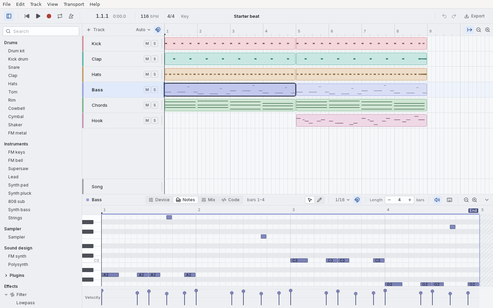

# music2

**In short**
- music2 is a music studio for Linux and the Mac: a DAW (digital audio workstation), the kind of app people make songs in, like GarageBand or Logic Pro.
- In music2 a song is a folder, and the folder is a small program. Code says how the song sounds: the instruments, the effects and the mix. Data files say what plays: the notes, the automation (knob moves over time) and the audio.
- The app shows that folder as a timeline, a piano roll, knobs and cables, and a code editor. Every change you make there is written into the files at once.
- It is made for people new to making music, and it aims to stay simple yet elegant enough for a producer.
- There's no AI inside the app. Scripts and AI agents can work on a song through the same files, the `m2` command and a local API. While the song is open, an agent's change goes through the app: you see each one land, you can take it back, and it waits while you hold what it changes. Press V to hear before and after it: that only changes what you hear, never the song. An agent can see what you select (`m2 focus`), follow what happens (`m2 watch`), point at things to show you where they are (`m2 point`), and measure what it can't hear (`m2 listen`: loudness, peaks, bands, stereo and masking, in a program of its own that never touches playback). It can make any change to the song the window can (`m2 call`; `m2 routes` lists them all), but playing, recording, soloing and your view stay yours.



*The Starter beat, with its Bass clip open in the piano roll (Linux).*

## Status

music2 is young: there is no 1.0 and no release yet. You build it from source. Before 1.0 the song format, the SDK and std can still change, and an old song may need a line changed to open ([goals](docs/goals.md)).

| System | State |
|---|---|
| Linux on x86_64 (Ubuntu 24.04) | Works. Every change is checked here. |
| macOS on Apple silicon | Works. Checked by hand on the owner's Mac, which is the reference for timings. |
| macOS on Intel | Not supported. |
| Windows | Not yet. It is the next platform step. |

What works today:

| You can | |
|---|---|
| Start a song from a template, or open an example | the start screen |
| Add tracks: 22 built-in sounds, a Sampler, or audio | **+ Track** (⌘T) |
| Draw and edit notes, clips and automation | the piano roll and the timeline |
| Turn knobs, add effects, connect cables | **Device** (⌥1) |
| Mix: faders, pans, mute, solo, meters, buses and sends | **Mix** (⌥3) |
| Play a MIDI keyboard or the computer's keys, and record notes or audio | ⌘K, or plug a keyboard in; R records |
| Bring in WAV and MIDI files | drag them onto the window |
| Play CLAP plugins, and open their own windows | the browser's **Plugins** |
| Export the song, its stems, or the notes as MIDI | **Export** (⇧⌘E) |
| Edit the song's code, with type checks | **Code** (⌥4) |

Keys are shown as on a Mac. On Linux, Ctrl does what ⌘ does, and Alt what ⌥ does. The full list, and how to do each thing, is in the guide's [What you can do](docs/guide/what-you-can-do.md). What is missing is in [What music2 can't do yet](docs/gaps.md).

## Quick start

You need [Rust](https://rustup.rs) (the repo picks the version itself) and [Node.js](https://nodejs.org) 24.

**1. On Linux, install the system libraries first** (Ubuntu 24.04):

```bash
sudo apt install pkg-config build-essential libasound2-dev libwebkit2gtk-4.1-dev libgtk-3-dev libsoup-3.0-dev librsvg2-dev libdbus-1-dev
```

**2. Get the code, build the window's UI, and run the app:**

```bash
git clone https://github.com/BreadBowlAI/music2.git
cd music2
(cd web && npm ci && npm run build)
cargo run --locked --release -p music2-desktop
```

The first build takes a while. Then the start screen opens.

**3. Make a song.** Click **New Song…**, keep **Starter beat**, and press **Create**. Press **Space** to play. The song lives in `~/Music/music2/<its name>`. To learn step by step, open **Help → Make Your First Song**, or read [Your first song](docs/guide/first-song.md).

Other ways to run it (the UI with hot reload, `music2.app` for the Mac, the `m2` command line) are in [Install and run music2](docs/guide/install.md).

## Learn more

| To | Read |
|---|---|
| Use the app | [The guide](docs/guide/welcome.md) |
| Learn the music words | [Music basics](docs/guide/music-basics.md) |
| Write songs as code | [How a song is written](docs/guide/code.md) and [Song as a program](docs/song-as-program.md) |
| Drive the app from a script or an agent | [Working on a music2 song](templates/song-agents.md) (every new song gets it as its `AGENTS.md`) and [the local API](docs/guide/api.md) |
| Know where the project is going | [Goals](docs/goals.md) |
| See what is missing | [What music2 can't do yet](docs/gaps.md) |
| Read the rules every part is built to | [The contract](docs/architecture.md) |

The guide (`docs/guide/`) is also a website, <https://breadbowlai.github.io/music2/>, once the repo is public, and `m2 docs` prints it in the terminal.

## Help build it

You are welcome, and so are AI coding agents. Read [CONTRIBUTING.md](CONTRIBUTING.md) first: the goals, the rules, and the one command to run before a pull request. Agents start at [AGENTS.md](AGENTS.md).

- Found a bug, or have an idea? [Open an issue](https://github.com/BreadBowlAI/music2/issues/new/choose).
- Found a security problem? Please report it in private: [SECURITY.md](SECURITY.md).
- Everyone follows the [Code of Conduct](CODE_OF_CONDUCT.md). Who decides what: [GOVERNANCE.md](GOVERNANCE.md).

## Licence

music2 is yours to use under either of

- the MIT licence ([LICENSE-MIT](LICENSE-MIT)), or
- the Apache License, version 2.0 ([LICENSE-APACHE](LICENSE-APACHE)),

at your option. Unless you say otherwise, anything you send for inclusion is under the same two licences, with no extra terms.

The app's font, [Inter](https://rsms.me/inter/), is under the SIL Open Font License 1.1 (`web/public/fonts/OFL.txt`). Credits: [the guide](docs/guide/credits.md).
