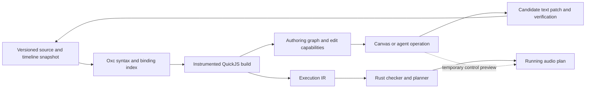

# Code and graph editing design

Design proposal, 11 October 2026. Responds to [the editing brief](code-graph-editing-brief.md) and builds on [Song as a program](song-as-program.md). The APIs below describe the broader design, not a claim that every operation is implemented.

**Current implementation:** the canvas supports a restricted literal-editing subset with a `LiteralLens` that reads a numeric source range and proposes a replacement. Identity resolution and independent candidate verification remain in `Session`. Direct literals, negative literals without intervening comments, unit constructors and unambiguous object properties are editable; computed/indirect expressions and ambiguous objects are read-only. Shared recorded unit values have a named source node and visible consumer connections. Preview requests identify the open project session, revision and control; they use the same numeric normalization as save. Invalid drafts disable edits. Unit values are opaque to JavaScript (no `.value`, no arithmetic), so every use of a written value is visible to the graph. Previews and commits carry a drag across saves that don't touch its value. Cables (`edit/cable.rs`) connect and disconnect within one file: an outlet is a `const` bound to a call that returned one top-level signal (the SDK records each call's output); connecting writes its name in place of a control's written value, and disconnecting writes the default the receiving ports declare, refusing when they declare none. Both are verified by comparing graphs up to node numbering: connecting must equal the old graph with that value's constants rewired to the outlet, and disconnecting must give a graph that rewires back to the old one. Effects (`edit/effect.rs`): packages declare insertable effects in their manifest (`[[effect]]`); adding one wraps a call's audio where it is written (`pluck(…)` → `delay(pluck(…))`, importing the name if needed), and removing unwraps it. Both are verified by taking the effect call's own nodes out and reading its input in place of its output, which must give exactly the graph without it. Undo and redo cover every edit made through the session; a structural edit is reverted only while the code is exactly as that edit left it. Cross-file cables (exports/imports), adding and deleting arbitrary nodes, generalized alias tracing, multi-client preview leases and the performance measurements below remain future work.

**Built:**
- `LiteralLens` edits of written literals (`core/session/src/edit/lens.rs`), and sites (`core/script/src/sites.rs`).
- Cables within one file (`edit/cable.rs`).
- Adding and removing effects (`edit/effect.rs`).
- Undo and redo through the session.

**Not built yet:**
- The descriptor-style `component()` below. What was built is `component({ controls: [...] }, fn)`, which only names the control paths.
- `key()`.
- The split into `EditCapability` and `BuildArtifacts`.
- Inserting omitted arguments, and reset to default. (Double-clicking a knob sets the middle of its range.)
- Rename, automate, extract, and connecting across tracks.
- Preview leases, the journal and crash recovery, and the editor bridge.
- The `EditRequest`/`EditResult` prepare/commit protocol.
- A `core/edit` crate. Editing lives in `core/session/src/edit/`.
- The property tests and the performance table.

**Build a source editor whose second interface is a component graph.** Compile TypeScript into both an authoring graph and the existing execution graph. Give each editable argument a small, checked source lens: a way to read its value and propose a precise text change. Let components declare their musical controls, and retain those controls as addressable values in the runtime.

This preserves ordinary TypeScript, makes instruments genuinely reusable, and gives the artist direct control without asking the editor to invert arbitrary JavaScript.

## The essential decisions

1. **The canvas displays the abstractions the author wrote.** A `bass(...)` invocation is a component with inputs and outputs. Its oscillators and filters live inside it. The execution graph remains available for inspection.
2. **Identity belongs to an occurrence, not its name.** Binding names label occurrences. Revision-aware syntax matching preserves their identities; explicit keys cover cases where implicit matching cannot.
3. **A control is a signal; a setting is a JavaScript value.** Cutoff, gain, and mix can change during playback. Voice count and algorithm selection rebuild the component. This distinction is the foundation of a correct fast path.
4. **Editability is a capability of a particular operation at a particular revision.** A node can have an editable cutoff, a connected resonance input, and a generated body that is inspection-only.
5. **Verify an edit in an isolated candidate snapshot before publishing it.** Derive the expected change independently from the semantic operation. Never mutate the working files and then try to roll them back.
6. **Preview is a temporary performance gesture.** It does not become saved song state until the corresponding source edit has passed verification.

The useful SwiftUI lesson is the separation of an ephemeral declaration from persistent identity and state, together with explicit identity for repeated content. Music2 should apply that principle to DSP instances and musical controls. Apple's explanation of structural and explicit identity supports this analogy; the source-editing machinery proposed here is a separate design. [Demystify SwiftUI](https://developer.apple.com/videos/play/wwdc2021/10022/)

## The code artists write

Keep the current functional syntax. Named bindings make routing readable; nested calls remain fully legitimate.

```ts
export default track("Bass", ({ lane, time }) => {
  const cutoff = lane.control("cutoff", "hz", hz(500));
  const drop = lane.mask("drop");
  const wobble = xrange(lfo(time.beats, { period: 0.5 }), hz(200), khz(2.5));

  return bass(lane.notes("notes"), {
    cutoff: blend(cutoff, wobble, drop),
  });
});
```

There is no requirement to introduce a binding for every unit value, arithmetic node, or nested effect. The editor can address the `2.5` above without expanding or reformatting the expression. Extract a binding only when an operation needs an addressable output in another expression, or when the artist requests a name.

Avoid introducing JSX, a second graph language, or a mandatory fluent chain. Audio is a directed graph with sharing, multiple outputs, feedback, and cross-track references. Ordinary bindings express those relationships well. The elegance should come from the component model and predictable editing, rather than a more elaborate spelling of the same graph.

### Rules for the house style

These are capability-oriented lint rules, not additional conditions for playing a valid song.

| Rule | Benefit | When it is broken |
| --- | --- | --- |
| Prefer immutable `const` bindings with one declaration per statement | Straightforward insertion, deletion, and reference analysis | Mutable flows can compile; dependent structural edits lose their lens |
| Prefer direct calls to resolved imports or registered components | Known ports and construction boundaries | Dynamically selected callees display as generated groups |
| Use literal property names and ordinary options objects | Arguments have unambiguous addresses | Computed keys, accessors, and uncertain spreads limit editing locally |
| Use signal operations for musical arithmetic | Controls stay live and typed | JS computations remain build-time expressions |
| Reserve JS branching and loops for settings and construction | A knob cannot secretly change topology | Controls used in construction conditions produce a diagnostic |
| Return a signal or an object of named signals | Exports are explicit | Unsupported export forms remain inspectable if they compile |
| Name outputs that need reuse; allow inline one-use expressions | Clean routing without excessive boilerplate | Extraction is an explicit structural edit |
| Use stable keys for reorderable generated instances | Reordering preserves state | Unkeyed repetition has limited identity guarantees |

Lint messages explain the missing operation: “This spread prevents resetting cutoff; add an explicit cutoff property.” They do not say that an otherwise valid track is invalid. Do not automatically normalize a file when it opens.

## Components declare their own interface

**Not built yet.** Add an optional `component` constructor for package authors. It returns an ordinary callable function. A descriptor defines the call shape, signal kinds, defaults, settings, and outputs once. From that definition the SDK derives TypeScript types, the inspector, and the build boundary.

For example, this proposed descriptor uses one primary positional input and an options object:

```ts
export const bass = component({
  id: "std/bass",
  input: port.events("note"),
  controls: {
    cutoff: control.hz(600).range(20, 20000).log(),
    drive: control.db(4).range(0, 24),
  },
  settings: {
    voices: setting.int(4).range(1, 64),
  },
  output: port.audio(1),
}, (notes, { cutoff, drive: amount, voices }) => {
  const body = poly(notes, n => {
    const tone = osc.saw(n.pitch);
    const env = adsr(n.gate, { attack: ms(3), release: ms(80) });
    return vca(svf.lowpass(tone, cutoff), env);
  }, { voices });

  return drive(body, amount);
});
```

This simplified instrument illustrates the contract, not a replacement for the existing bass implementation. Its callers still write `bass(notes, { cutoff: hz(800) })`.

At entry, the wrapper normalizes every control to a graph signal. A literal or omitted control creates one addressable constant source for that instance and port. A connected signal retains its connection. The body always receives a `Control<...>`, including when the caller omitted the argument. Defaults are applied here; the body does not repeat them with `??`.

Consequently, ten internal uses of cutoff share one control source. `scale(cutoff, 4)` stays in the graph and responds to preview updates automatically. The ordinary integer `voices` remains available for construction-time decisions.

Reject numerical coercion of signals with `Symbol.toPrimitive`, and lint control use in JS conditions. JavaScript object truthiness cannot be intercepted: `if (cutoff)` therefore requires static checking, not a promise that a runtime hook catches it. Unknown code without a proven control contract does not earn a live-preview capability.

Display ranges are UI hints unless declared as validation constraints. Do not silently clamp a typed value to a widget's preferred range. Check the actual expanded ports and kinds in Rust; metadata cannot override the checker.

Generate direct kernel wrappers and port schemas from existing kernel manifests. Add small explicit adapters for convenience wrappers: positional-to-port mappings, the selected output of `svf.lowpass`, and conversions such as an oscillator accepting semitone pitch. A manifest alone cannot infer those source APIs. Composite component defaults live in the component definition. Package content hashes pin definitions, adapters, and descriptors. Existing ordinary functions remain supported, with narrower inferred capabilities or an explicit adapter; TypeScript types alone cannot describe defaults, editing policies, or realtime safety.

Dictionary components such as `mixer` additionally declare a repeated channel schema. The channel key identifies a strip; nested `in`, `db`, and `pan` are addressable fields. This avoids teaching the core about hats, buses, or a particular mixer implementation.

Distinguish an always-present control with a default from an **optional structural feature**. The current mixer creates a panner only when `pan` is present; omitting it preserves the input's channel shape, while `pan: 0` creates a stereo panner. Its schema must preserve that distinction. Enabling or removing pan rebuilds the strip; changing an already-present pan value can preview. The same presence rule applies to its optional gain node. Do not normalize every optional property to a signal and thereby change existing songs. Migrating a legacy wrapper requires before/after execution comparisons for both omitted and explicit arguments.

## Two derived graphs and one source



The authoring graph records component invocations, nested scopes, bindings, semantic argument slots, connections, and exact source origins. It also includes declared but disconnected components, so adding a node need not immediately connect it to the master output. It is rebuilt from source and is never serialized as authoritative song structure.

The execution IR keeps its small set of audio operations. A component boundary need not become an executable opcode. A separate origin table relates execution nodes to authoring instances and component ports. One authoring instance can own many execution nodes; one input signal can feed several instances.

### Static analysis and recording work together

Before stripping types, retain original UTF-8 byte ranges, comments, tokens, lexical symbol resolution, argument positions, and nested object paths. A source map for generated JS is useful for diagnostics but insufficient for editing.

Assign source-site identities and instrument supported call forms. Evaluate the callee, its receiver, and arguments in original JavaScript order, exactly once. Enter the component recording frame only for the actual invocation, after its arguments have been evaluated. Otherwise, in `bass(notes, { cutoff: lfo(...) })`, the LFO is incorrectly classified as part of the bass implementation.

Preserve `this` for member calls, exceptions, lexical scope, and callback timing. Use compiler-generated temporaries or narrow invocation helpers; do not apply an indiscriminate `withSite(() => expression)` transformation. Begin with resolved SDK/component calls. Unsupported call forms still run and receive conservative provenance.

QuickJS recording supplies the invocation hierarchy and actual signal flows. The source index supplies writable locations. Neither can replace the other. Never infer provenance by matching numerical values, and never box arbitrary JS numbers to trace them. Both would fail on repeated values, ordinary arithmetic, or JavaScript semantics.

### Compile products

```ts
type SourceRange = {
  file: string;
  contentHash: string;
  startByte: number;
  endByte: number;              // half-open UTF-8 range
};

type BuildArtifacts = {
  snapshot: Revision;
  authoring: AuthoringGraph;
  execution: CheckedIr;
  origins: OriginTable;
  edits: EditCapability[];
  controls: ControlBinding[];
  diagnostics: Diagnostic[];
};

type EditCapability = {
  id: string;                  // revision-bound opaque capability
  instance: InstanceId;
  slot: string;                // e.g. "cutoff" or "channels.hats.pan"
  operations: string[];
  source: SourceRange[];
  lens: string;                // core lens implementation identifier
  sharing: InstanceId[];
  preview: "live" | "rebuild" | "none";
  reason?: string;
};
```

Byte offsets stay inside the compiler/session boundary. Frontends and agents target instances and slots, never stale character offsets. An editor bridge explicitly converts UTF-8 byte ranges to the editor's position encoding.

## Identity and lifetime

**Not built yet.** Use distinct identities for distinct purposes:

| Identity | Meaning |
| --- | --- |
| `SiteId` | A source occurrence, such as an inline filter call or binding declaration |
| `InstanceId` | A site within a particular component invocation and repetition key |
| `ControlId` | An instance's semantic input slot, independent of its current literal or connection |
| `SourceValueId` | The source value edited by a lens; several control slots can refer to it |
| `RuntimeId` | An instance plus an internal node role, used to locate DSP state |
| Binding name | A human-readable label and lexical reference |
| Content hash | Cache validity; never a substitute for persistent identity |

An instance path combines its module identity, parent invocation, local site, and explicit repetition key where present. Internal package sites are namespaced by their component instance. Two calls to `bass` must never share oscillator state simply because both expand from the same package source.

Reconcile sites between snapshots in this order: explicit operation correspondence, explicit keys, unchanged text mapped through the edit, then unique structural matches using scope, resolved callee, argument shape, and binding-reference relationships. Ignore binding spelling and literal values in the relevant matching features. A unique `cutoff` to `bright` rename should retain identity. Matching is one-to-one; copy/paste creates a new occurrence.

Persist reconciliation information in a versioned, rebuildable editor index alongside layout metadata. It contains source hashes and site correspondences, not graph behavior. Missing or stale metadata can lose layout continuity, but must not change a fresh render. Never derive random seeds or musical defaults from editor IDs. The continuity of an already-running performance is distinct from the deterministic meaning of saved source.

**Arbitrary external refactors cannot guarantee identity.** Two indistinguishable unkeyed calls can be swapped with no evidence of which old state belongs to which new occurrence. Report ambiguity and allocate fresh identity rather than attaching another oscillator's state by guesswork. A restart after unobserved edits has the same limit.

Provide a scoped escape hatch:

```ts
const lead = key("lead", () => bass(notes, { cutoff: hz(800) }));
```

`key` establishes identity before constructing the enclosed graph; it does not change its signal. Keys must be unique within the relevant parent scope. For generated banks, offer a keyed iteration helper with a separate stable item key, never the editable frequency or current array index. Plain loops continue to work without that guarantee.

State reuse requires both identity and compatibility: kernel implementation/state ABI, channel shape, relevant construction settings, and voice-scope ownership. Preserve unchanged instances in a runtime-owned arena. Prepare a new schedule and new instances off the audio thread, then transfer ownership at a block boundary; do not process a retained instance in both old and new plans. Retire allocations away from the audio callback. An incompatible change resets or crossfades according to a defined policy. Identity alone does not make raw state transferable between Wasmtime stores.

## Source lenses and minimal edits

A lens is a deliberately small partial operation over syntax: “set this numeric token,” “set this named property,” “replace this input expression,” or “rename this resolved symbol.” It reports preconditions, source ranges, expected semantic effects, and why it cannot apply.

Use Oxc for parsing and semantic indexing, plus the original source bytes and a token/comment index. Use a local snippet printer for insertions. Do not print the whole AST back to the file. Oxc already supplies a Rust parser in the current stack; Recast's preservation model is useful prior art, but adding a JS editing runtime is unnecessary for these bounded edits. [Oxc parser](https://oxc.rs/docs/guide/usage/parser), [Recast](https://github.com/benjamn/recast)

### Literal behavior

| Source | Knob behavior |
| --- | --- |
| `0.3`, `-12` | Edit the numeric expression, including its sign if necessary |
| `hz(800)`, `db(-6)`, `ms(30)` | Preserve the resolved unit constructor; edit its numeric argument |
| `khz(2.5)` dragged to 900 Hz | Write `khz(0.9)`; unit conversion for readability is a separate command |
| `2 * 440` | Display the expression; offer explicit “replace expression with value” rather than choosing an operand |
| `scale(cutoff, 4)` | Display its connection; the `4` is editable on the scale component, not as the destination's independent value |
| `const bright = hz(800)` referenced once | May follow a proven immutable alias to its literal |
| A constant with several uses | Present a shared control and show affected uses; “make independent” replaces only the selected use |

Recognize unit constructors by resolved symbol, not spelling. Preserve surrounding parentheses, comments, quote style, and numeric style when a correct spelling is possible. Quantize to the control's declared resolution, normalize to canonical units, and verify that the emitted literal reads back to that value. Do not accept NaN or infinity. A no-op set emits no patch.

### Arguments and options

**Not built yet.** An omitted argument has an insertion lens. It is still a real semantic slot, with a default owned by the descriptor. Setting it materializes source only when the gesture commits. A positional argument beyond omitted earlier positions may require explicit `undefined` placeholders; preserve the signature's semantics.

Reset means “inherit the declared default.” Remove an explicit property where safe; do not merely write today's default value, since that changes what a later package update means. An explicit pinned default remains distinguishable from inheritance even if the current audio graph is equivalent. For an optional structural feature, reset restores absence and follows the rebuild path; it is not a scalar preview to zero.

For `{ ...o, cutoff: hz(800) }`, the trailing explicit property wins. For `{ cutoff: hz(800), ...o }`, it may not. Offer “override here” by appending a final property only when ordinary object semantics and the component contract make that safe. Do not silently mutate a shared options object. If removing a property would reveal a spread's value, reset-to-default may be unavailable; explain the distinction from “remove local override.”

Fallbacks such as `o.cutoff ?? hz(600)` in legacy builders are construction logic. Edit the caller's argument when a descriptor supplies that contract. Otherwise expose only the literal fallback at its definition, with its shared scope visible. Do not pretend the fallback belongs to every caller individually.

### Structural gestures

**Not built yet**, except connect and disconnect (within one file) and adding and removing effects, which work as described in the "Current implementation" paragraph at the top.

| Gesture | Source operation and restrictions |
| --- | --- |
| Connect | Replace the destination input with an in-scope binding/export; extract an inline producer once if needed; check type, capture scope, and cycles |
| Disconnect | Use the declared default, or an explicit supplied fallback; never guess a previous value from hidden UI state |
| Add | Insert an imported, collision-free `const` before its uses, with required inputs specified; a disconnected valid declaration may remain on the canvas |
| Delete | Find all semantic references; require replacements for required consumers or an explicit cascade; remove only covered bindings and edges |
| Rename | Rename the lexical symbol and its references; preserve public object keys and exports using explicit properties when needed |
| Automate | Replace a local control value with `lane.control(id, unit, fallback)` and create its lane data in the same transaction |
| Stop automating | Replace that use with an explicit sampled value; preserve a still-shared lane and retain unreferenced data unless deletion is requested |
| Expose or connect across tracks | Add a producer export, consumer import, and input reference; existing private/public names remain distinct |
| Extract group | Identify inputs, captures, outputs, and state correspondence; create a component/module with an explicit correspondence map |
| Move | Change layout only |
| Open | Navigate to the invocation or definition; installed package source is inspected, while customization forks it into the project |

Disconnect cannot reliably recover “the previous literal” after the file has been saved and reopened: the code no longer contains it. Undo can restore it from history. A required audio input without a declared fallback remains connected until the artist chooses bypass, a replacement, or a cascade. The descriptor may declare a valid silence fallback; the editor must not invent one for every port.

Deleting a node must not quietly delete everything downstream. Return the affected consumers so the UI can make a concrete composite operation. Keep orphaned explanatory comments, or move them with an explicit extraction; do not silently discard comments while removing their adjacent statement. A source patch includes the necessary delimiters and insertion whitespace, and leaves every byte outside its declared ranges unchanged.

## Exact verification

Define verification over the entire frozen project snapshot, including package versions and timeline data. “The intended graph change” means a checked structural change under a specified operation, not a claim of general equivalence between arbitrary programs or identical audio samples.

Let `Build(S)` return the authoring graph, typed execution graph, and lane contracts for snapshot `S`. For operation `O`:

```text
B        = Build(S)
Expected = ApplySemanticOperation(B, O)
Patch    = PlanSourceEdit(S, B, O)
Actual   = Build(ApplyPatch(S, Patch))

Accept only if:
  Actual authoring delta matches O
  Normalize(Actual execution) == Normalize(Expected execution)
  Actual lane/data delta matches O
  untouched source bytes are identical
  all preconditions still hold at publication
```

The semantic operation and source patcher are separate modules. The expected result must not be “whatever compiling the candidate produced.” A scalar set changes one control source and its documented fan-out. A connection changes one semantic input edge. Add/delete operations name the introduced or removed component and all affected connections.

For registered components, expand the expected authoring graph from the same pinned component definitions, in isolation from the candidate text, with the requested arguments and frozen dependencies. Only re-expand affected components; their boundary captures must be declared or proven. A setting may legitimately replace an internal subgraph, but the expected expansion defines which one. Sharing the component implementation is appropriate; sharing the text mutation path would make verification circular. Unregistered arbitrary helper code gets fewer structural operations when the expected expansion cannot be isolated.

Replayable components must also have an enforced construction-effect contract: they create owned nodes and read declared inputs, without mutating module globals, external objects, another instance's feedback node, or undeclared lane/export state. A conservative source effect check follows resolved helper calls and permits local owned mutation; unknown escaping calls or writes lose isolation eligibility. The recorder rejects graph mutations outside the active ownership boundary. A descriptor's assertion alone is insufficient. This gives isolated expansion the same meaning as the original invocation; components that cannot establish the contract still run through the ordinary whole-program build with reduced edit capabilities.

Canonical comparison ignores source coordinates, labels, allocation-order IDs, and generated buffer indices. It includes resolved kernel implementations, kinds, units, normalized values, connections, component settings, voice bodies/counts, feedback, imports/exports, root output, and lane contracts. Compare declared authoring content as well as reachable execution content so dead-code pruning cannot hide an unintended edit. Preserve inheritance-versus-explicit-value state in the authoring comparison.

Match new and surviving nodes through the operation's correspondence map and origin roles, not arbitrary graph isomorphism or a nearest-name heuristic. Ambiguity is a verification failure. Compute expected values with defined numeric normalization; do not use an audio-render tolerance to mask unexpected graph differences.

On failure, discard the candidate, revoke its preview, and return the unexpected delta and source location. Capability failure is scoped to the operation and revision: a conflict or transient compile error does not permanently mark the node uneditable.

## Instant preview and accepted playback

Keep three explicitly different states:

- **Draft:** the latest source and timeline snapshot, possibly invalid.
- **Accepted:** the most recent completely checked snapshot.
- **Preview:** a leased override on controls in an accepted plan.

Expose the revision actually playing as well: while a prepared plan awaits activation, it can briefly trail the accepted revision. The UI must not claim a build is audible before the audio thread acknowledges activation.

At pointer-down, request a preview lease bound to a capability, accepted revision, source value, expected input sources, and runtime generation. A compiler-produced `ControlBinding` maps that `SourceValueId` to the complete set of affected `ControlId`s. The lease atomically reserves the source value and that entire control set. Other controls remain available. The audio thread receives bounded value messages through a preallocated queue, coalesces superseded values, and applies each complete update at one block boundary with a declared ramp. No compilation, allocation, file I/O, or synchronous IPC occurs in the callback.

This matters for `const bright = hz(800)` passed to two different instruments: each component has its own input cell, but editing their shared source must preview both. Two knobs cannot acquire competing leases to the same literal. Changes to the alias's use set invalidate the lease. Grant a shared live capability only when every affected use has a proven runtime mapping; otherwise offer a rebuild-only definition edit or an explicit local copy.

Keep the same control identity for inherited defaults, explicit values, and connections, but issue live scalar preview only while the current source is an eligible constant. A connected control offers editing of its source or an explicit disconnect; dragging must not silently override a cable or automation.

On release, hold the final preview while planning and verifying the source edit. Publish the new revision, then remove the override in the same activation step that installs the committed base value. This avoids a momentary return to the old value. Failure or cancellation ramps to the newest accepted value, not necessarily the value at pointer-down. A lease timeout/client disconnect also releases the override. Offline renders use committed source/data only.

In `poly`, each existing and future voice reads the same outer control cell or an explicitly scoped voice control mapping. There must be no per-voice file edit. Changing a lane's fallback is separate from overriding automation at the playhead; its preview should reflect fallback semantics, including that it may be inaudible while a clip supplies the lane.

Legacy computed arguments may be editable through rebuilds while lacking a live capability. Never promise no-rebuild preview for a JS value that selects a branch, changes loop count, or is transformed by untracked arithmetic.

## Concurrent editing and undo

Use optimistic concurrency on semantic dependencies, not a file-wide lock during a drag. A prepared operation records the input slot/value it read, the binding and scope dependencies, relevant descriptors, lane paths, and source hashes.

When new text arrives, build a new snapshot and reconcile identities. If a disjoint edit moved the literal, resolve the current capability and replan against the new snapshot. Recompute the expected result against that new base, preserving the unrelated edit. If the target's value, connection, identity, settings, or dependencies changed, return a conflict. Non-overlapping byte ranges alone are insufficient evidence of independence.

For an agent editing `bass.ts` during a cutoff drag: a comment change can rebase; a resonance edit can rebase if dependencies are unchanged; a cutoff edit conflicts; removing the bass or changing its parameter ABI cancels preview. An accepted plan switch carries a preview forward only after explicit lease revalidation. Avoid last-writer-wins for the same control.

While the draft is invalid, show the accepted graph and current diagnostics. Initially, disable source-changing graph operations until there is a valid base; layout changes remain available. An optional, clearly labeled audition on the accepted plan can continue, but releasing it does not save into invalid source. Do not overwrite half-typed code, silently fork a hidden source branch, or queue a commit that may occur unexpectedly later.

For remote participants and agents using the API, serialize acceptance through one session authority with revision guards and idempotent operation IDs. A CRDT can merge editor text later, but it would not decide whether two conflicting rewires are musically compatible.

### Atomicity has a precise boundary

Immutable snapshots allow atomic session acceptance and one audio-plan activation even when a transaction changes several files. Write a durable journal with complete before/after blobs and a commit decision; publish only after verification and durable recording. Materialize files with staged writes, tag the watcher batch, and recover interrupted writes on restart. Never destructively recover over an externally changed file; retain the divergent version and surface a conflict.

**Several ordinary filesystem paths cannot be replaced atomically for arbitrary external readers.** A watcher debounce does not solve this, and a hash check followed by rename has a race with another writer. Without cooperation, even guaranteed capture of every overwritten version is impossible.

Therefore provide two explicit integration levels. Session/API clients and an editor bridge use versioned transactions and receive the full no-lost-update guarantee. Ordinary direct disk edits are supported through watching, stable reads, best-effort conflict detection, and recovery copies, with the unavoidable race disclosed. The session never knowingly overwrites a differing version. Strict concurrent saving requires the bridge or exclusive ownership of the affected files. Revise the existing “engine is the only writer” principle to “the session is the only authority for accepting playback revisions.”

### One gesture is one undoable intent

Preview updates never enter history. Store the committed transaction, forward and inverse semantic operations, byte patches, identity correspondence, and before/after data blobs. Undo applies a guarded inverse to the current snapshot and verifies it. It does not restore an old whole-file snapshot over someone else's work. If the edited slot has since changed, undo returns a conflict.

The editor bridge associates text changes and app commands with transaction IDs, so the same change is not undone twice; it applies changes into dirty editor buffers with document-version checks. Without that bridge, text-editor undo is simply another external edit and app undo cannot share its stack. Do not claim that independent undo systems can be made globally coherent by observing disk saves. Source undo restores song configuration, not elapsed time or a previous audio performance.

## The operation protocol

**Not built yet.** Both the canvas and agents use the same structured operations. The session computes patches and expectations; clients cannot supply a permissive expected-delta mask to bypass verification.

```ts
type EditRequest = {
  id: string;                        // idempotency key
  base: Revision;
  capability?: string;
  op:
    | { kind: "setValue"; target: SlotRef; value: Quantity }
    | { kind: "setSetting"; target: SlotRef; value: string | number | boolean }
    | { kind: "resetDefault"; target: SlotRef }
    | { kind: "connect"; from: OutputRef; to: SlotRef }
    | { kind: "disconnect"; target: SlotRef;
        fallback: { kind: "default" } | { kind: "value"; value: Quantity } }
    | { kind: "add"; scope: ScopeId; component: string;
        binding: string; arguments: Record<string, Argument> }
    | { kind: "delete"; target: InstanceId; replacements: Replacement[] }
    | { kind: "renameBinding"; target: InstanceId; name: string }
    | { kind: "automate"; target: SlotRef; lane: string; fallback: Quantity }
    | { kind: "stopAutomation"; target: SlotRef; value: Quantity;
        sampledAt: { accepted: Revision; beat: number }; keepData: boolean }
    | { kind: "renameLane"; module: ModuleId; from: string; to: string }
    | { kind: "connectAcrossTracks"; from: OutputRef; to: SlotRef;
        exportName: string };
};

type EditResult =
  | { status: "committed"; transaction: string; revision: Revision;
      activation: "pending" | "active"; patch: FilePatch[];
      effect: SemanticDelta; identities: IdentityMap;
      verification: { authoring: "passed"; execution: "passed";
        timeline: "passed"; text: "passed" } }
  | { status: "conflict"; current: Revision;
      reason: "targetChanged" | "dependencyChanged" | "identityAmbiguous";
      base: unknown; currentValue: unknown; requested: unknown }
  | { status: "rejected";
      reason: "draftInvalid" | "unsupportedEdit" | "typeMismatch"
        | "unexpectedDelta" | "staleCapability" | "writeConflict";
      diagnostics: Diagnostic[]; unexpected?: SemanticDelta };
```

These shapes describe the core contract; production schemas also include cancellation, access checks, lock diagnostics, bounded payloads, and version negotiation.

Returned file patches distinguish source replacements from file operations:

```ts
type FilePatch =
  | { kind: "edit"; file: string; beforeHash: string; afterHash: string;
      edits: { startByte: number; endByte: number;
        expectedText: string; replacement: string }[] }
  | { kind: "create"; file: string; mustBeAbsent: true; contents: string }
  | { kind: "rename"; from: string; to: string;
      beforeHash: string; destinationMustBeAbsent: true }
  | { kind: "delete"; file: string; beforeHash: string };
```

Apply disjoint edits against the same original buffer, from the highest offset downward. A lane rename uses one rename operation plus its source edits in the same transaction; it does not reconstruct the lane's contents. Case-only renames need a filesystem-specific staged path and collision check. These guards are enforceable for session-owned snapshots; they do not turn ordinary disk writes into cross-process compare-and-swap.

Preview messages are separate: `begin(capability, acceptedRevision)` returns a lease and normalized value; `update(lease, sequence, value)` ignores out-of-order messages; `commit(lease, finalSequence, finalValue)` submits one edit; `cancel(lease)` revokes it. The explicit final value prevents a dropped preview packet from changing the saved result. Begin can report `busy`, `notLive`, or `stalePlan`.

Provide `prepare(request)` for a source diff and verified effect, and `commit(preparedId)` with fresh precondition checks. Normal GUI gestures can call a combined execute endpoint. Preparing does not guarantee that a later commit will still apply. Journal operation IDs so network retries cannot duplicate an automation lane or added node. Emit revision, diagnostic, preview-cancellation, and activation events to every subscribed client.

## The twelve hard cases

| Case | Required behavior |
| --- | --- |
| 1. Unnamed nodes | Every call occurrence has a site. `vca(svf.lowpass(x, hz(800)), env)` exposes the filter and its literal lens without adding a binding. Extract only when another expression needs its output. |
| 2. Value spellings | Preserve numeric and unit spellings; canonicalize only the value. Expressions and shared references follow the explicit policies above. |
| 3. Defaults and spreads | Descriptors provide omitted-slot insertion. Respect evaluation order and last-property precedence; uncertain spreads disable unsafe operations. Legacy fallbacks are not per-instance defaults without a contract. |
| 4. Library instruments | A registered call becomes one component. Its descriptor defines controls/settings/outputs; recording supplies actual internals. Never infer its entire public interface from nodes reached in one execution. |
| 5. Poly bodies | Show one editable voice template, not one graph per playing note. Represent note fields and outer captures as boundary ports. Rewrite a capture in lexical scope; prohibit voice-local signals escaping directly. Preserve live voices only under the runtime compatibility policy. |
| 6. Nonbinding statements | Model `fb.set(x)` as the feedback node's input assignment with its own lens; require one recognized setter. Return object properties are export slots. Mixer object fields are keyed nested slots. These are recognized syntax forms, not exceptions handled by regex. |
| 7. Loops | Initially show a generated group with inspectable instances. Do not claim a particular output owns array literal `400`. A later keyed-collection lens may edit that element only after proving its source path and exact affected expansion; generated item identity must survive changing its frequency. |
| 8. Outside rename | Use lexical/structural reconciliation, not spelling. Retain a uniquely matched identity; explicit keys cover ambiguity and major refactors. |
| 9. Overlapping edits | Revalidate leases and semantic read sets. Rebase independent edits; conflict on a changed target or dependency. |
| 10. Invalid code | Keep accepted playback and diagnostics. Source-changing canvas edits wait for a valid snapshot; optional audition remains visibly transient. |
| 11. Lane contracts | Rename source declaration and timeline path in one journaled session transaction. Check normalized-name collisions, case-only renames, every reference, data existence, and timeline validity. |
| 12. Formatting | Adapt insertions to the local file. Preserve untouched bytes and comments. Formatting the whole file is an explicit separate operation, never a knob side effect. |

Lane IDs and track names are data addresses, unlike ordinary binding labels. Renaming a variable called `cutoff` must not rename `timeline/bass.cutoff.json`. A lane rename preserves the complete data file, including clips and metadata, and changes only the addressing contract. A track display-name change currently also affects timeline slugs and therefore needs the same migration treatment. A future stable track/lane data ID can separate these concerns, but requires an explicit format migration.

“Stop automating” samples an explicit accepted revision and beat in canonical units. This makes the kept value deterministic even if the transport moves while the transaction is being prepared. If the lane has other consumers, detach only the selected one. Existing automation remains data, not a reconstructed curve in code.

## Changes to the existing implementation

| Area | Required change | Status (October 2026) |
| --- | --- | --- |
| `core/script/src/lib.rs` | Retain original source/token/semantic indexes before stripping; instrument supported calls; load through an immutable source provider instead of reading candidate code from live disk | Partly built: calls are instrumented (`sites.rs`, with byte ranges and argument structure), and a candidate compiles from an in-memory snapshot. |
| `core/script/sdk/core.ts` | Add component descriptors and invocation frames; normalize control inputs; record origin roles and instance paths; preserve scopes and argument ownership | Partly built: `component({ controls })` names control paths, and each node records the call it was made inside. Descriptors are **Not built yet**. |
| `core/ir/src/lib.rs` | Version provenance references and stable semantic IDs; keep component descriptions separate from executable ops | Partly built: every node has an `origin` (site and argument path). Stable IDs are **Not built yet** (ids are counters). |
| `core/ir/src/check.rs` | Retain control addresses through flattening and constant folding; expose a canonical checked representation before pruning loses authoring information | Partly built: a constant with an origin is never folded into a kernel input, so it stays addressable. |
| `core/runtime/src/lib.rs` | Add prepared control cells and preview messages, voice mappings, and a runtime ownership model for state retention and plan activation | Partly built: `Renderer::set_const` previews a value everywhere it is used, voices included. State retention and plan activation are **Not built yet**. |
| `core/session/src/lib.rs` | Add snapshots, candidate verification, revision acceptance, journaling, conflict detection, undo, and subscription events around the current compile operation | Partly built: snapshots, candidate verification, revisions, conflict detection and undo (`core/session/src/edit.rs`). The journal and subscription events are **Not built yet**. |
| New `core/edit` crate | Own syntax lenses, capability derivation, semantic operation planning, byte patches, and graph-delta comparison | Partly built, inside `core/session/src/edit/` rather than as its own crate: the literal lens, byte patches and graph comparison. |
| `core/song` | Read timeline data from snapshots; implement lane/track path migration and guarded data edits | Partly built: timeline data is read from snapshots, and notes lanes are written by a checked edit. Path migration is **Not built yet**. |
| `std/src` | Generate direct kernel wrapper descriptors, declare convenience adapters, and progressively register instruments, effects, and dictionary components | Partly built: effects are registered as `[[effect]]` entries in `std/m2pkg.toml`. Generated wrappers are **Not built yet**. |

When this was written, the core had two consequential gaps. The first is closed. The checker used to fold connected constants into `Input::Const`, so a preview could not work just by updating the original IR constant. Now a constant with an origin is never folded: it stays its own node (`core/ir/src/check.rs`), and `Renderer::set_const` refills it everywhere it is used, voices included, at the next block. A knob drag previews live this way, without a separate `Input::Param` cell.

The second is still open. The core runtime is a renderer with a Wasmtime store, while the session supplies compilation and timeline validation. A running-state arena and atomic plan activation are **Not built yet**: an edit that changes the graph builds a new renderer and replays it up to the playhead. The transactional editor exists for single edits (`core/session/src/edit.rs`); multi-edit transactions are **Not built yet**.

## Prototype sequence and acceptance tests

Build a narrow vertical slice before extending the language surface. Keep the original `first-song` code as fixtures rather than rewriting it into easier input.

1. Snapshot-backed compilation, origin tables, capability inspection, and canonical comparison.
2. Numeric/unit lenses and live control cells, tested on `khz(2.5)`, the LFO period, and `song.ts` channel pan.
3. Connections and local insertion/deletion, including conversion of the concise root arrow to a block when a binding is needed.
4. Automation with atomic source/data transactions and guarded undo.
5. Outside-edit reconciliation, editor bridge, crash recovery, and state retention under plan changes.
6. Component extraction, keyed generated collections, and richer project-helper analysis after the first five are reliable.

The executable prototype should demonstrate these exact operations:

| Fixture | Operation | Expected text |
| --- | --- | --- |
| `tracks/bass.ts` | Drag wobble maximum to 900 Hz | Only `2.5` becomes `0.9` |
| `song.ts` | Drag hats pan | Only `0.3` changes |
| `tracks/bass.ts` | Connect wobble directly to bass cutoff | Replace the cutoff argument's `blend(...)` expression with `wobble`; leave now-unused declarations alone |
| `tracks/bass.ts` | Disconnect that cutoff to the registered default | Remove the explicit cutoff property, preserving other properties/comments |
| `tracks/bass.ts` | Add a delay after bass | Extract the returned bass call into a fresh binding, insert a delay binding/import, and return it |
| `tracks/bass.ts` | Delete that delay with bypass | Restore the source connection, remove the delay binding; leave import cleanup to an explicit safe rule |
| `song.ts` | Add then delete a node | Exercise concise-arrow expansion, nested mixer arguments, and comment preservation |
| `song.ts` | Automate hats pan | Bind the song callback's lane context, replace `0.3` with a lane call, and create `timeline/song.hats-pan.json` |
| `tracks/bass.ts` | Automate an independent LFO period | Replace its value with a typed lane input only if the wrapper exposes period as a live control |

What was built handles these cases differently:
- **Connecting** replaces a written literal with the outlet's name; it doesn't replace an expression such as `blend(...)`.
- **Disconnecting** writes the default the input declares in place of the name, rather than removing the property.
- **Adding a delay** wraps the call where it is written (`bass(…)` → `delay(bass(…), {…})`) instead of extracting bindings.
- Deleting with bypass, adding and deleting other nodes, and automating are not built yet.

Adding an effect to an expression-bodied arrow necessarily changes syntax around that body. Preserve existing expression bytes and comments where possible and declare the added braces/return as part of the patch. Minimal means the smallest correct edit for that operation, not that every gesture changes a single range.

Use property-based generators over the supported grammar. For every emitted capability and permitted operation, assert: the patched source parses; compilation and timeline validation pass; the independent semantic result matches the full normalized graph; bytes outside patch ranges are identical; comments survive; identity correspondence is injective; a no-op has no diff; a guarded inverse restores the original source/data when no intervening edit exists. Test operation sequences, not just isolated edits.

Adversarial cases include duplicate identical calls; copy/paste and reorder; shadowed unit helpers; aliases with several uses; negative/exponential literals; Unicode before spans; CRLF; comments inside unit calls and property lists; trailing commas; ASI boundaries; spreads with getters; duplicate/computed keys; shorthand properties; captured outer signals; illegal voice escapes; feedback setters; cross-track cycles; package changes; lane slug collisions; invalid intermediate files; disjoint and overlapping saves; dropped/reordered preview messages; stale plans; retries after uncertain commits; and crashes at every journal/materialization step.

Differentially run representative supported programs with and without instrumentation and compare execution meaning. This detects the particularly dangerous class of bugs where provenance recording itself changes evaluation order or receiver behavior.

Realtime checks should verify that every intended sink and existing/new voice receives the preview, a failed commit restores the latest accepted value, and no old-value block occurs at successful handoff. Test audio-thread allocation/locking bounds separately from semantic edit correctness.

## Performance budget

**Not built yet.** The brief reports roughly 70 ms for a full four-track `m2 check`, including process startup and kernel compilation. That is an existing measurement from the brief, not a measurement of the proposed editor. It supports starting with full candidate rebuilds while keeping the process and packages warm.

| Path | Design target | What to measure |
| --- | --- | --- |
| Preview | Apply by the next audio block after receipt; no rebuild | Event receipt, block application, and physical output latency separately |
| Scalar commit | Under 100 ms at p95 on the example, after warmup | Plan patch, candidate build/check, comparison, durable commit |
| Structural edit | Audible in 100–200 ms at p95 on a typical track | Include plan preparation, state retention, and audio activation |
| Outside edit | Refresh shortly after a stable valid save | Watcher delay, build, reconciliation, and activation |

At 48 kHz, 64 samples are about 1.33 ms and 128 are about 2.67 ms. These are block durations, not guaranteed knob-to-speaker latency: GUI event scheduling, IPC, buffering, and the audio device add time.

Start with cached parsing/transformation and package/kernel loading, one compiler worker, cancellation of obsolete builds, and full-project verification. Keep QuickJS module state isolated between builds; caching transformed code must not reuse mutable builder globals. Add dependency-based incremental builds only when measured work justifies the complexity. Maintain a record of environment, package hashes, cold/warm runs, p50/p95, project sizes, and total wall time. The prototype must produce actual numbers before these targets become product claims.

## Alternatives and remaining questions

| Alternative | Decision |
| --- | --- |
| Binding names or byte positions as identity | Reject as primary identity; both are normal editing targets |
| Mandatory UUID annotations on every call | Reject as default; readable scoped keys are an escape hatch, while reconciliation handles ordinary code |
| General inverse evaluation of arbitrary TypeScript | Keep as research, not the production edit path; ambiguity and nonlocal effects undermine predictable gestures |
| Pure static extraction | Insufficient for actual component expansion and generated graphs |
| Pure runtime tracing | Insufficient for primitive-value provenance, exact writable ranges, and lexical refactoring |
| A second saved graph with generated code | Reject; it would make source cease to be authoritative |
| Full-file formatting after every edit | Reject; makes unrelated text changes and damages concurrent editing |
| Silent downstream deletion or hidden disconnect values | Reject; these would turn routine gestures into surprising source semantics |
| CRDT first | Defer; consistent text alone does not establish a valid or intended music graph |

Sketch-n-Sketch demonstrates evaluation-driven updates and custom lenses in a functional language. Adopt the idea of domain-specific inverses, while limiting the first implementation to explicit, checkable operations. [Bidirectional Evaluation with Direct Manipulation](https://arxiv.org/abs/1809.04209)

Figma Code Connect explicitly maps component properties to code properties; that is useful precedent for component descriptors. MPS directly edits an AST, which would conflict with preserving ordinary TypeScript files as the authority. Hazel gives incomplete programs meaning through typed holes in its language; that does not make arbitrary incomplete TypeScript safely executable. These are reasons to choose bounded source lenses and last-accepted playback here. [Code Connect](https://developers.figma.com/docs/code-connect/react/), [MPS basic notions](https://www.jetbrains.com/help/mps/basic-notions.html), [Hazel](https://hazel.org/)

Treat Max/gen~, Houdini/VEX, Blender geometry nodes, and Blueprints as interaction references for groups, ports, and navigation. They do not establish the free-text round-trip contract required here; no part of this design depends on assuming that they do.

The remaining engineering risks are syntax reconciliation under large refactors, proving preview eligibility for legacy helpers, parameter-cell retention through optimization, Wasmtime instance ownership during hot swap, and coordinated saves into dirty external editor buffers. Keep the initial operation set small enough to verify completely. The first success criterion is a clean, verified `0.3 → 0.45` edit that sounds immediate and survives a concurrent unrelated save; the rest of the system should extend that same contract.
