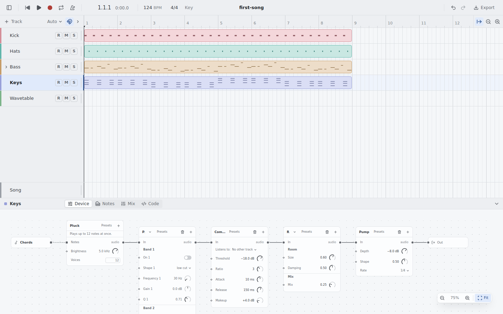
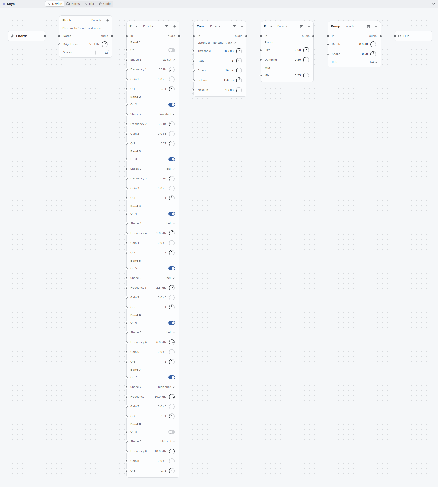
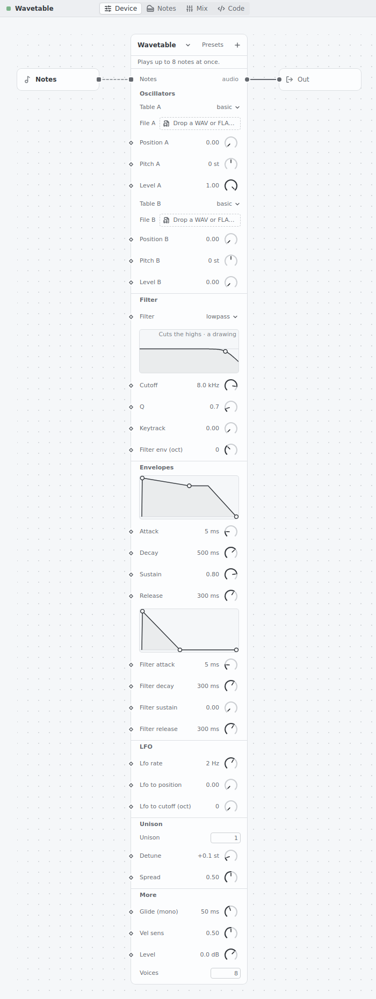
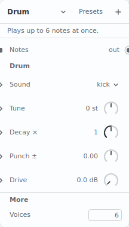
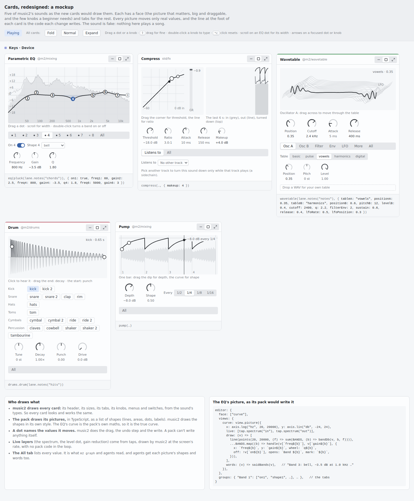

# Cards you play with: a face, tabs, and pictures that packs draw

| | |
|---|---|
| **Status** | Accepted by the owner on 2026-11-06 ("yes to all": D1 to D17 as recommended in §7). Revised after the skeptic's review (K1 to K15, §9 of this note). |
| **Written** | 2026-11-06, from `main` at `de95d95a` |
| **Builds on** | [Typed sounds](../cards/design.md) (accepted 2026-10-31): values typed, "the type says what, never how to draw it" (§2.2), views (§3.2), groups (§3.3), taps (§5), and §9's "no pack code in the window" |
| **Gaps** | #59 (a spectrum view and the EQ's curve); the filter view that draws only a low-pass (gaps.md, Not built yet) |
| **Mockup** | `$SCRATCH/cards2-note/mockup.html`: five cards you can drag, made with fake sound ([picture](images/mockup.png)) |

**In short**
- **Today a card is a long list.** One knob per row, top to bottom. The Parametric EQ is 40 rows and 1,872 px tall, with no picture of its curve. Nothing you drag shows what you hear.
- **The new card has a face and tabs.** The face holds the one or two pictures that matter, drawn big, and the four to six knobs a beginner needs. You drag the picture itself: the EQ's dots over its live spectrum, the compressor's curve, the envelope's corners, the wavetable, the drum's hit, Pump's dip. Everything else goes in tabs, and a card's groups become its tabs. The last tab, All, lists every value.
- **A card has three sizes.** Folded is one line and a small picture. Normal is the face and one tab. Expanded is the face drawn bigger, with every tab side by side.
- **Packs draw pictures, not whole cards.** music2 always draws the card: its frame, knobs, menus and tabs. A pack may add pictures: TypeScript that turns the card's values into a list of shapes, which music2 draws in its own style. A pack can't design a whole card from scratch. That is on purpose: a beginner learns one card, and every sound then works the same way.
- **The pack's picture code runs on music2's server,** in the sandbox where pack code already runs, never in the window. Measured, a drag's curve follows in about 2.5 ms (4.5 ms at worst), well inside one screen frame (16.7 ms).
- **What moves comes from the sound itself.** The spectrum and the levels are taps. A sound's code may send music2 a few **meters** (how much a compressor turns down, where an LFO is, when a drum hits), which nothing in the song can hear. A curve that can be measured (an EQ, a filter, an echo) is measured from the sound's own code, not redrawn from the pack's maths.
- **This keeps §9 and changes §2.2 in part.** No pack code runs in the window. But a pack can now draw a picture made of shapes. Knobs, menus, switches and the shape words stay music2's.
- **What the core gains, counted honestly (§6.1):**
  - 23 SDK words and 3 descriptor fields;
  - 1 route and 1 socket message;
  - 3 server parts: the picture runner, the offline measure, and the spectrum and levels;
  - more rings, 2 new tap points, and meter outputs for kernels;
  - meter outputs on about six existing kernels.

  No new kernels.

## 1. What is wrong today

These pictures show the app at `de95d95a`: `examples/first-song`, with a Parametric EQ, Compress, Reverb and Pump added after the keys, and a Wavetable track. They were taken in headless Chrome from the headless server, in a scratch `HOME`.



*The dock at its usual size. Titles are cut to "P.", "Com…" and "R", and the knobs are 21 px at the 75% zoom.*



*The same chain at 100%. The EQ is one column of 40 rows, 1,872 px tall.*



*The Wavetable is 35 rows, 1,768 px tall. Its two envelopes and its filter are three small pictures among the rows.*



*The Drum: a menu and four knobs. It has no picture of the hit.*

| What is wrong | Where you see it |
|---|---|
| **A list, not an instrument.** Every value is a row: a label, a number, a 28 px knob. Nothing is bigger than anything else, so nothing tells you where to start. | every card |
| **No picture where one matters.** The EQ has no curve and no spectrum (gap #59). The compressor has no curve and no gain-reduction meter. Pump doesn't show its dip, the Wavetable doesn't show its table, and the Drum doesn't show its hit. | EQ, Compress, Pump, Wavetable, Drum |
| **The pictures we have are small and fixed.** There are four: envelope, filter, keys and scope. The filter view draws a 12 dB per octave low-pass, whatever the filter is. A new picture means a change to the core's closed list (CARD-16). | Wavetable's filter |
| **Groups are headings in a column.** The EQ's eight bands are eight headings, one under the other. Folding hides every group but the first. | EQ, Multiband, Wavetable |
| **The patch shows through.** Every row has a port diamond, and the card has an "In audio" row: cables you rarely want in a device chain. | every card in Device |
| **It doesn't fit.** At the dock's 300 px a card shows six rows. Fit zooms out to 75%, and titles are cut to one letter. | the dock |
| **Nothing moves with the music**, except a scope you must open. | every card |

What is good, and stays:
- One declaration (the descriptor) still drives the card, `m2 graph` and the API.
- A change still writes the code, with one undo step.
- Knobs keep taste.md §5.2's gestures: ⇧ for a fine drag, double-click to type, ⌥-click to reset.

## 2. What the best devices do (research)

Sources are the pages read on 2026-11-06.

| Device | What it does that people love | Source |
|---|---|---|
| Ableton EQ Eight | Drag a dot: across for frequency, up and down for gain. ⌥-drag for Q, and up and down for Q on a cut. A spectrum under the curve. The expanded view puts all eight bands in the main window. | [Live 12 audio effects](https://www.ableton.com/en/live-manual/12/live-audio-effect-reference/) |
| Ableton Compressor | Three views in one display: Collapsed (only the main knobs), Transfer Curve, and Activity (input grey, reduction orange). A gain-reduction meter. | same |
| Ableton Wavetable | You drag the table display to move through it. The filter has dots to drag. Tabs: Osc, Matrix, MIDI, Mod Sources. | [Live 12 instruments](https://www.ableton.com/en/live-manual/12/live-instrument-reference/) |
| Ableton, every device | One title bar: on/off, fold with a double-click, swap. Signal flows left to right, and an arrow toggles each device's expanded view. | [Working with instruments and effects](https://www.ableton.com/en/live-manual/12/working-with-instruments-and-effects/) |
| Ableton Racks | Up to 16 macros, 8 shown. Map one to any knob with a range. Variations save a set of macro settings. | [Racks](https://www.ableton.com/en/live-manual/12/instrument-drum-and-effect-racks/) |
| Bitwig | One gesture modulates any knob: click a modulator's port, then drag the target knob. Live markers show the modulated value. | [Unified modulation](https://www.bitwig.com/userguide/latest/the_unified_modulation_system/) |
| FabFilter Pro-Q 4 | The curve is the interface. Click to make a band (its shape depends on where you click), drag it, scroll for Q. A band panel floats under the band you picked. Spectrum Grab and a piano scale. | [Pro-Q EQ display](https://www.fabfilter.com/help/pro-q/using/eqdisplay), [band controls](https://www.fabfilter.com/help/pro-q/using/bandcontrols) |
| FabFilter Pro-C | A knee display (in against out) that lights with the live level. A big level history: in, out, and reduction as a line. A compact mode hides the displays. | [Pro-C displays](https://www.fabfilter.com/help/pro-c/using/displays) |
| Vital, Serum | Animated waveforms, filters and modulation at 60 fps. Drag a source onto a knob, and a ring on the knob shows the motion. | [vital.audio](https://vital.audio/), [Serum 2 knobs](https://xferrecords.com/web-manual/serum-2/using-knobs-and-sliders) |
| Logic Channel EQ | Drag the shaded band. An analyser over the curve, before or after the EQ. Each band's colour matches its button. | [Channel EQ](https://help.apple.com/logicpro/mac/10.4.5/en.lproj/lgcef1edc1d7.html) |

**Why they are loved:**
- **Direct manipulation.** You act on the thing you see, in small steps you can undo ([NN/g](https://www.nngroup.com/articles/direct-manipulation/)).
- **Live feedback.** The picture moves with the sound.
- **Progressive disclosure.** A simple face, with more one level down. NN/g advises two levels at most ([NN/g](https://www.nngroup.com/articles/progressive-disclosure/)).
- **Consistency.** One title bar and one modifier set everywhere.
- Sound On Sound says Pro-Q "reimagined the plug-in equaliser using the principles of good software interface design" ([review](https://soundonsound.com/reviews/fabfilter-pro-q-4)).

**How hosts let other people draw:**

| Host | How | The trade |
|---|---|---|
| VST3, CLAP | The plugin opens its own window and draws it with any code it likes; the host only sizes it ([CLAP gui.h](https://raw.githubusercontent.com/free-audio/clap/main/include/clap/ext/gui.h)). | Total freedom. No consistency, native code fully trusted, and each plugin must make itself accessible ([CLAP #225](https://github.com/free-audio/clap/discussions/225)). |
| Bitwig devices | The host draws every native device. Outsiders get remote-control pages, Grid patches and controller scripts ([Bitwig](https://bitwig.com/userguide/latest/midi_controllers)). | Perfect consistency, but no outsider can make a new face. |
| Max for Live | `live.*` widgets become Live parameters in Live's own colours. `v8ui` draws freely in JavaScript ([v8ui](https://docs.cycling74.com/reference/v8ui), [parameters](https://docs.cycling74.com/userguide/m4l/live_parameters)). | A kit gives consistency. Custom drawing loses the theme unless the author works at it. |
| REAPER JSFX | `slider` lines make an automatic UI. `@gfx` is a small drawing API the host runs about 30 times a second, on a thread apart from the audio ([JSFX](https://www.reaper.fm/sdk/js/js.php), [gfx](https://www.reaper.fm/sdk/js/gfx.php)). | Cheap and safe, but it draws pixels, so every author's looks different. |
| iPlug2, NIH-plug, Elementary | The plugin's own webview, talking to the host in JSON ([iPlug2](https://iplug2.github.io/docs/class_web_view_editor_delegate.html), [nih-plug-webview](https://github.com/maxjvh/nih-plug-webview), [SRVB](https://github.com/elemaudio/srvb)). | Quick to build with web tools. It is still the plugin's own window, heavy, and unchecked. |
| The web | A sandboxed iframe with `postMessage`, an OffscreenCanvas in a worker, or Shadow DOM ([iframe](https://developer.mozilla.org/en-US/docs/Web/HTML/Reference/Elements/iframe), [OffscreenCanvas](https://developer.mozilla.org/en-US/docs/Web/API/OffscreenCanvas), [Shadow DOM](https://developer.mozilla.org/en-US/docs/Web/API/Web_components/Using_shadow_DOM)) | The iframe is a real wall. A worker draws pixels no one else can read. Shadow DOM is no wall at all. |
| Faust | An abstract widget tree (`hslider`, `tgroup` for tabs, metadata such as `[unit:dB]`, `[scale:log]`) that any host draws ([Faust](https://faustdoc.grame.fr/manual/syntax/)). | Any host can draw it, automate it and make it accessible, but it can't draw a picture of its own. |
| Figma, VS Code | Declared UI first. A sandboxed webview only "when absolutely necessary" ([VS Code](https://code.visualstudio.com/api/ux-guidelines/webviews), [Figma](https://developers.figma.com/docs/plugins/how-plugins-run/)). | Consistent and accessible. The escape hatch is discouraged. |

**The pattern:** the systems people like best start from a typed description the host draws. Some add a narrow, sandboxed way to draw, and every value it changes is still a host parameter.

## 3. The new card

### 3.1 Its parts

```
┌──────────────────────────────────────────────┐
│ Parametric EQ  @m2/mixing        [–][▢][⤢]   │  header: name, its pack (or std), three sizes
├──────────────────────────────────────────────┤
│  ┌────────────────────────────────────────┐  │
│  │  spectrum (live) under the curve       │  │  the face: the picture that matters,
│  │      ②──③      ⑤──⑥                    │  │  big; you drag the dots
│  │  ①/        ╲④╱        ⑦──⑧             │  │
│  └────────────────────────────────────────┘  │
│  [•1 •2 •3 •4 •5 •6 •7 ∘8 | All]             │  tabs: the descriptor's groups, then All
│  On ●  Shape [bell ▾]   (Freq) (Gain) (Q)    │  the tab's values
├──────────────────────────────────────────────┤
│ eq(pluck(…), { gain4: -3.5, freq4: 800 })    │  the code it writes (Normal and Expanded)
└──────────────────────────────────────────────┘
```

| Part | What it is | Declared by |
|---|---|---|
| **Header** | The name, the pack it comes from (or `std`), ⋯ (as today) and the three sizes. An instrument's card has its track's 3 px colour bar along its top (taste.md §3.5). | the descriptor's `label` |
| **Face** | At most two pictures and at most six values, drawn big | `editor.face: ["curve", "cutoff", …]` (**new**); with no face, the first group is the face |
| **Tabs** | One tab for each group, in their order, then **All** | `editor.groups` (as today, CARD-17) |
| **All** | Every value in one list, with its home and its id for `m2 set`: what `m2 graph` prints and what an agent reads | nothing: every card has it |
| **The code line** | The call as the code writes it, updated as you drag. Shown in Normal and Expanded, not Folded. | nothing |

- A picture's dot can name the tab it **opens**. Picking EQ band 3's dot shows the "3" tab, and picking the tab marks the dot.
- A tab whose values include a switch named `on…` shows that switch as a dot on the tab, filled when it is on (the EQ's bands). This is presentation; it changes nothing.
- A tab bar too wide for the card scrolls, and fades at its edge until you reach the end (a phone's EQ).
- The ports and the "In audio" row leave the Device chain. They stay in Patch, where cables are the point (taste.md §3.5 already says Device is a chain).

### 3.2 Knobs

- They keep taste.md §2.8 and §5.2: a 270° arc, 300 px for the full range, ⇧ for fine, double-click to type, ⌥-click to reset, and the value bubble while you drag.
- **In a grid, not a list.** Columns of 64 px hold the knob, its label and its value. A face's knobs are 36 px; a tab's are 28 px.
- **Menus with five options or fewer** are a segmented control (Pump's rate, the filter's shape). Longer ones stay menus. A choice of many related options, such as the Drum's 17 drums, is a grid of chips grouped by family.
- **A switch** is a switch, as today.
- **A recording** is its waveform, as today: drop a file on it.
- **Defaults** show in `fg-muted`, and a written value in `fg` (HOME-1, taste.md §2.10).

### 3.3 Sizes

| Size | Shows | Width (normal; a phone is always full width) |
|---|---|---|
| **Folded** | The header, one sentence ("7 bands on · −3.5 dB at 800 Hz") and its first picture, 40 px tall and still. No code line. | 240 px |
| **Normal** | The face, the tab bar, one tab and the code line | the card's own (EQ 460, Compress 480, Wavetable 440, Drum and Pump 380) |
| **Expanded** | The face drawn bigger, every tab side by side, All behind a disclosure, and the code line | about twice the normal width |

- The size is the window's own, like today's fold (`web/src/lib/folded.ts`). It is not the song's, so it writes nothing.
- The sentence comes from the picture's `words` (§4.4).

### 3.4 Keyboard

| Where | Key | Does |
|---|---|---|
| a knob | ↑ ↓ (→ ←) | one step (1% of a plain range, a 1% ratio in Hz, 0.1 dB, a semitone); with ⇧ ten steps, as taste.md §5.2 says, which wins over this note's first draft (⇧ for 0.1%) |
| | PageUp, PageDown | 10% |
| | Home, End, ⌫ | its lowest, its highest, its default |
| | Enter (double-click) | type a value: "−3", "2k", "120ms" |
| a picture's dot | ← → | its x value (the EQ: a sixth of an octave) |
| | ↑ ↓ | its y value (the EQ: 0.5 dB) |
| | ⌥↑ ⌥↓ | its wheel value (the EQ: Q) |
| | Enter, Space | its `toggles` value (the EQ: the band on or off) |
| the tab bar | ← → | the next or the previous tab |
| a card | Tab | header, face dots, face knobs, tabs, the tab's values, in that order |

The size buttons are in the tab order. A shortcut for them waits for taste.md §5.1's map (D7).

### 3.5 What an agent sees

The API must still show everything (AGENT rules; CARD-1, CARD-25, CARD-26).
- **Every value** is in the view as today, whatever tab it is on. All is that same list, drawn.
- **The face and the tabs** are in the view (`ViewNode.face`, `ViewNode.groups`), and `m2 graph` prints them as headings.
- **Every picture's words** are in the view ("Band 4: bell, −3.5 dB at 800 Hz"), with each dot's knob ids and whether the card can move it. `m2 graph` prints the words.
- **A picture's shapes are data, sent on request.** The view would grow too much with them in it (§4.6; the whole view of `first-song` is 30 KB). A window asks for the shapes of the pictures it shows, and an agent asks for the ones it wants (`POST /api/graph/picture`). Either way the answer is the same: the curve's points, each dot's place and the values it moves. An agent reads the EQ's curve as numbers, never from pixels.
- **Live layers** are taps and meters an agent can ask for as a window does (TAP-8). An agent's spectrum ask gets the bins in each answer.
- **A value on a hidden tab** that an agent changes lights its tab. An agent's pointer at it shows on the tab, as a folded card's "N more" row does today (CARD-25, review V8).

## 4. The standard for packs

### 4.1 The question

The owner asked for "a standard so that 3rd party packages can design the cards from scratch". Here are the ways to answer, in order of how much a pack controls:

| | What a pack can do | Where its code runs |
|---|---|---|
| **A. More host views** | Pick from a bigger list of pictures music2 draws: an EQ curve, a transfer curve, a spectrum, an XY pad, a meter, a wavetable, a step grid | nowhere: it only names them |
| **B2. Shapes, on the server** (recommended) | Option A's card, plus pictures it draws: TypeScript that turns the card's values into shapes, which music2 draws. A dot names the values it moves; music2 does the drag, the write and the undo. | the server, in a QuickJS sandbox, where pack code runs at each build today |
| **B1. Shapes, in the window** | The same as B2, and the same shapes | a locked worker in the window, with no page access |
| **B3. Both** | The same as B2 | a locked worker draws while you drag; the server draws the truth (agents, release, folded cards) |
| **C. Its own HTML and JavaScript** | Anything: the whole card is the pack's web page | the window, in a sandboxed iframe |

A worker that draws pixels (an OffscreenCanvas) is worse than B1 in every way that matters: agents can't read pixels, and every author's looks different. So it isn't a contender.

### 4.2 How they compare

Measured by the skeptic on the shared Linux server (32 cores, under a load of 11 to 14), with `core/script`'s QuickJS (rquickjs 0.14, its libm Math). The picture is an 8-band EQ curve at 180 points, 8 dots and its words. Sources: `$SCRATCH/cards2-note/review/bench/`, `review/result-preview-rt.txt`.

| Path | median | p99 |
|---|---|---|
| QuickJS: the draw, its words and `JSON.stringify` into Rust | 1.16 ms | 2.15 ms |
| `/preview` round trip, headless Chrome to the headless server (dev build) | 1.30 ms | 2.30 ms |
| **B2, both together** (the answer is about 8 KB of shapes) | **about 2.5 ms** | **about 4.5 ms** |
| B1: the same draw in a Web Worker, posted and answered | 0.10 ms | 0.30 ms |
| one screen frame at 60 fps | 16.7 ms | |

| | A | B2 (recommended) | B1 | B3 | C |
|---|---|---|---|---|---|
| **For a beginner** | Every card the same | Every card the same: music2 draws every shape, knob and dot in its style | the same as B2 | the same as B2 | Every pack a new app |
| **RISC: what the core grows by** | One widget for each new kind of picture, without end; each is Rust, React, a rule and tests | the picture words and a picture runner, **once** (§6.1); then every picture is a pack's TypeScript | the same words, and a worker host in place of the server runner | both runners | a web host, a message protocol, permissions |
| **Safety** | no code runs | **No pack code in the window.** It runs in the build's sandbox: `Date`, `performance`, `Math.random`, `eval` and `Function` gone, a memory limit and an interrupt (`core/script/src/lib.rs`'s prelude; checked, review K15). It can't write: it returns shapes. | A stranger's code in the window. A worker has `fetch`, `WebSocket`, `importScripts` and IndexedDB, and the app sets no CSP (`tauri.conf.json`: `"csp": null`), so a pack could phone home unless the worker is locked down. Stopping it is one call (`Worker.terminate()`). | B1's risk while you drag | A stranger's page in the window |
| **Agents see what the musician sees** | yes | yes: the shapes are data | yes, if the server can run the same code | yes | no |
| **Speed while you drag** | instant | about 2.5 ms (p99 4.5 ms): inside a frame | about 0.1 ms | about 0.1 ms | instant |
| **The work** | medium for each picture, without end | large once (about track `views`), then small for each picture | large once | the largest of the B's | the largest |
| **How close to Ableton and FabFilter** | as close as the host's list allows | close: a pack draws anything made of shapes, over curves measured from its own sound | the same as B2 | the same as B2 | as close as the author's skill |

Measured against §9's three reasons for refusing pack window code:
- B1 breaks only the first: "code from strangers in the window".
- B2 breaks none.
- B3 breaks the first while you drag. It also runs every picture in two engines, whose floats may differ (QuickJS uses libm here; JavaScriptCore has its own Math).

### 4.3 Recommendation: B2

- **music2 draws the card; a pack may draw pictures, as shapes, computed on the server.**
- **A pack can't design a card from scratch, and that is the point.** Every card has the same header, the same knobs, the same tabs and the same gestures, so a beginner who has learnt one card can play any pack's sound. An agent can read every card. A sound that truly needs its own whole window is what a CLAP plugin is, and plugins already have their own windows.
- It is the RISC answer. The core gives one general way to draw. Every picture is TypeScript: the EQ's in `@m2/mixing`, the wavetable's in `@m2/wavetable`, the shared ones (envelope, transfer curve, level history) in std.
- B2's speed is measured, and inside a frame on this machine. Before track `pictures` lands, it must also be measured in the Tauri webview (WebKit on the Mac, WebKitGTK on Linux), against the budget in §4.4.
- **B3 stays a later way out (D17), not built now.** It is the plan if a heavy picture, or WebKit's numbers, miss the budget. A cleaner B3 would run QuickJS compiled to wasm in the worker: the same engine, with no web APIs at all. That needs a new npm package or a wasm build of `rquickjs-sys`, so it would be its own decision.

**How it changes the accepted design (the owner should see this plainly):**

| The accepted design said | This proposal |
|---|---|
| §9: "Packs bring their own window code (HTML and JavaScript)": rejected, because of strangers' code in the window, packs that all look different, and agents who can't see in | **Kept.** No pack code runs in the window. A picture's code runs in the server's sandbox, and the window draws only shapes in music2's own style. Agents read the shapes. Option C stays rejected for the same reasons. |
| §2.2: "A pack can't add a widget: the vocabulary is closed and small" | **Changed in part.** The widgets (knob, menu, switch, number box, recording) and the picture words are still closed. A pack can now combine the words into a picture of its own. |
| §3.2: four views, `envelope`, `filter`, `keys`, `scope` | **Two of the four become pictures** in std (D5): `envelope` and `filter`. `keys` (it plays audition) and `scope` stay music2's. So do the live layers, the waveform and the measured curve (§4.6, §4.7). |
| CARD-16, CARD-27: the filter view draws a 12 dB per octave low-pass, and says it is a drawing | **Better.** A filter's curve is measured from its own sound code (§4.7), so it is the real curve. |

### 4.4 What a picture is

```ts
import { view, axis, live } from "@m2/core";

curve: view.picture({
  x: axis.log("hz", 20, 20000),          // music2 draws the grid and its labels
  y: axis.lin("db", -24, 24),
  live: [live.spectrum("in", { tone: "faint" }), live.spectrum("out")],
  draw: (v, p) => [
    p.response(),                        // the curve, measured from the EQ's own kernel (§4.7)
    ...BANDS.map((b) => p.handle(v[`freq${b}`], v[`gain${b}`], {
      x: `freq${b}`, y: `gain${b}`, wheel: `q${b}`, toggles: `on${b}`,
      off: !v[`on${b}`], opens: `Band ${b}`, mark: `${b}`,
    })),
  ],
  words: (v) => saidBands(v),            // "Band 4: bell, −3.5 dB at 800 Hz; …"
}),
```

**The words.** The list is closed. Adding a word is a change to the contract.

| Kind | Words | Says |
|---|---|---|
| the picture | `view.picture({ x, y, live, draw, words })` | `words` is required: one sentence for the folded card, `m2 graph`, agents and screen readers |
| axes | `axis.lin(unit, lo, hi)`, `axis.log(…)`, `axis.time(seconds)` | music2 draws the grid and its labels as taste.md formats them |
| shapes (the pack works them out) | `p.line(points, { tone, name })` | a line through points, in the axes' units; `name` lets a live layer sit on it |
| | `p.fill(points, { base, tone })` | a filled shape: closed, or down to `base` (0 dB) |
| | `p.bars(points, { base, tone })` | bars (FM partials, delay echoes) |
| | `p.handle(x, y, moves)` | a dot you drag. `moves`: `x`, `y`, `wheel`, `toggles` (values), `opens` (a tab), `mark` (a short label), `off` |
| | `p.mark(axis, at, words?)` | a thin guide line (a threshold, a crossover) |
| | `p.label(x, y, words)` | a few words |
| | `p.play(box, { note })` | a place you click to hear a note through audition (MON-7), as hard as the click is high |
| | `knob(name)` | for a `moves` entry: the value moves as its knob's drag does (a compressor's ratio) |
| layers music2 fills in, once | `p.response()` | the curve measured from the call's own sound (§4.7) |
| | `p.hit({ note, seconds })` | one note's sound, rendered from the call's own sound (§4.7) |
| | `p.waveform(setting)` | a recording, or a table the pack ships, drawn by music2 |
| live layers (music2, at the screen's rate) | `live.spectrum(point)` | the sound's frequencies |
| | `live.level(point, { on })` | a dot: x the level, y on the line `on` names (the compressor's dot rides its curve) |
| | `live.meter(name)` | a bar from a meter the sound's code sends (gain reduction) |
| | `live.history(of)` | a level or a meter over time, on a time axis |
| | `live.playhead(from)` | a moving line: the song's beat (Pump), or a meter (an LFO's phase) |
| | `live.value(name)` | a dot's place as a lane or a cable moves it while the song plays |
| | `live.scope(point, { from })` | the sound's waveform, or a capture from the last hit (`from: "hit"`, up to 1 s) |

**What stays out:** pixels. A spectrogram, a heat map of a table, a free drawing. They need a canvas the pack paints, which agents can't read and which would look like each author. If music2 wants a spectrogram later, it is a host layer like `live.spectrum`. Dots that move list items (a step sequence's steps) are out too: notes and steps are edited on the timeline and the beat grid.

**The rules:**

1. **A dot moves only this card's values, checked by type.** `draw` gets a builder `p` typed by the descriptor and the axes, so `p.handle(…, { x: "freq3" })` must name a control of this descriptor whose unit fits the x axis (Hz on a Hz axis), as CARD-16 checks a view's names. TypeScript marks a mistake on the handle. A name worked out as the code runs (`` `freq${b}` ``) can only be checked then. The picture runner checks every draw's names, and a wrong one greys the picture in words: "Parametric EQ's picture names freq9, which it doesn't have".
2. **music2 does the gesture.** A drag is a knob's gesture: leases, preview, one `Values` Tx at release, one undo step (CARD-22). A dot moves each value by how far the pointer moved, in its axis's own scale (on a log axis, by a ratio), from where the value was. This holds even when the dot isn't drawn at its value, such as the envelope's decay corner, which sits at attack plus decay. It moves only the way the pointer went, and stays in the knob's range (CARD-27). A value that isn't on an axis (a compressor's ratio, Pump's depth drawn as a foot) moves through `knob()`. A pack never writes anything.
3. **`v` holds what plays.** That is the value written, or the default, or a lane's fallback; it is `null` under a cable or code that works it out. A dot that names a value the card can't move is drawn hollow and fixed by music2, with its why in its tooltip (CARD-26, CARD-27). The pack doesn't have to.
4. **When `draw` runs:**
   - It runs when any value it reads changes. That includes a write, an agent's change, and a preview from any of the card's leases: a knob's drag on a tab moves the curve, not only a dot's.
   - The server makes at most one draw for each card for each frame, from all its leases at once. A dot that moves two values makes one draw, not two.
   - The shapes go once for each card on the socket, not in each knob's answer.
   - Under automation, `live.value` moves the dot with no draw. The curve follows a lane while the song plays only if D11 says yes.
5. **A budget.**
   - A picture's draw must take under **8 ms at p99** on the slowest Mac music2 supports. Past **20 ms**, or past its memory, it stops: it greys and says why ("Parametric EQ's picture took too long and was stopped"). The knobs still work, as a kernel past its deadline does (ABI-6).
   - Every bundled picture is timed on a fixed set of values. That test judges speed, so it runs in the nightly tier (AGENTS.md rule 3). The PR tier checks only that each picture draws, and that its names are right.
6. **music2 draws in its own style:** hairlines, its greys, the accent only on the picked dot, no gradients (taste.md §2.8). A pack chooses a tone, never a colour (D14 asks about one colour for each EQ band).

### 4.5 The picture runner

There is no kept-alive sandbox today. Each build makes a fresh QuickJS runtime on a thread of its own and throws it away (`on_own_thread` and `sandbox()` in `core/script/src/lib.rs`). The runner is new:
- **One thread for pictures**, apart from the session's. A compile of a few hundred ms must never freeze a curve mid-drag, for the reason a drag never waits on a compile (WRITE-22).
- **One runtime for each package version the song locks,** loaded from the store, and loaded again after `m2 upgrade`. **One runtime for the song's own code,** since a component a song declares may draw a picture too (D16). That one is made again at each accepted revision.
- **The prelude is kept:** no `Date`, no randomness, no `eval`, a memory limit (64 MB for each runtime).
- **A limit for each call.** Today's `Limit` counts from when the runtime was made, so a kept runtime would trip it for good. It must restart at every call.
- **`draw` gets frozen copies of its inputs.** Module state that changes between calls is not promised to survive: a runtime may be made again at any time.

### 4.6 Live layers: taps, meters and their budget

The live layers need more than today's taps, and this is a runtime change, counted in §6.1.

**Today** (`core/runtime/src/taps.rs`):
- A live plan has 5 rings: 1 for the loudness and **4 for scopes**, each 16,384 frames.
- A tap point is the song's output, a top-level node's first output, or an overlay site.
- Meter slots are laid out when a plan is prepared.

The mockup's Keys chain alone (EQ in and out, Compress in and out) would use every scope ring.

**What changes:**

| | Today | Proposed |
|---|---|---|
| Rings for each live plan | 5 | **32**, made with the plan off the audio thread: 32 × 16,384 frames × 2 channels × 4 bytes = 4 MB |
| Levels | peak slots laid out with the plan (meters) | read from a ring on the server (peak and RMS), so a new level needs no new layout |
| Points | the output, a top-level node's first output, an overlay site | also **a call's input** (the block that feeds it), and **a meter of a kernel inside a call**, a pack's own call included |
| Meters | none | **a kernel may give a meter**: an extra control output, named in its manifest, that nothing in the graph may read (the checker refuses a wire from it), so it changes no bit (RENDER-33). A plan has 256 meter slots, one number for each block, pointed like rings. |
| Inside an instrument's voices | not reachable | a meter there is read as the largest across the voices; a hit capture starts at the call's next note |

**Why meters, and not sums of levels** (review K2, measured): gain reduction worked out from level in and level out, read every 33 ms as the meters are, is wrong where a beginner looks. With a kick every 500 ms (threshold −18 dB, ratio 4, attack 10 ms, release 150 ms):
- **At a hit's start,** the levels say 0.0 dB where the compressor turns down 3.4 dB, and 1.6 dB against 8.9 dB on the next kick.
- **While it lets go** (1.8 dB falling to 0.6 dB), they say nothing, because in and out are both quiet. The release is set by watching exactly that.
- **The multiband's three bands** exist only inside its one kernel, so no tap outside it can show them.

One primitive, the meter, gives all of these:
- each compressor's, gate's, de-esser's and duck's gain reduction, and the multiband's three;
- whether a gate is open;
- where the Wavetable's LFO is;
- when a drum hits.

The sum of levels is wrong exactly where it matters.

**What is shown, and what it costs:**
- **Only what is on screen asks.** A picture's live layers ask while an `IntersectionObserver` sees them and the window shows, and stop when they are folded or scrolled away, as the scope does today (CARD-29). A folded card's small picture is still.
- **Over budget, it says so.** A 33rd live picture draws its shapes but not its live layers, and says in words: "No room for this live picture: 32 are moving. Fold a card or scroll it away."
- **The spectrum** is worked out on the server, off the audio thread. It uses a 16,384-frame FFT for the lows (2.9 Hz apart, so the kick and the bass are really measured) and a 4,096-frame one above 500 Hz, joined into about 120 bins at 1/12 of an octave, then smoothed. At 30 a second for 20 cards that is a few percent of a core. The audio thread only copies blocks into rings, as today (TAP-3).
- **Drawing:** live layers go on a canvas under the picture's SVG shapes. A canvas redrawn 30 times a second is cheap in WebKit; dozens of SVG paths redrawn that often are not.

### 4.7 Curves from the sound itself

A pack that draws its EQ's curve in TypeScript knows its maths twice. The kernel is Rust: `parametric.rs`, prewarped cookbook filters in f32, its frequency kept from 10 Hz to 0.45 × the sample rate, its gain to ±30 dB, its q to 0.05 to 50. The picture would be TypeScript. A clamp missed on either side, or a ladder filter drawn as a cookbook filter, shows a curve that isn't the sound: the drift CARD-27 warns about.

So a curve that can be measured is measured:
- **`p.response()`:** the server makes a fresh offline copy of the call's own sound at the card's values (written, or as they are being dragged). *As built (track `measure`, CARD-81 to CARD-85):*
  - **A step, not a click.** The graph has no click to play, and a new kernel would grow the core. So the copy plays a step (a note's key count, RENDER-39, scaled by std's `scale` to −20 dBFS), and the first difference of what comes out is the click's sound. For a sound that stays the same at every level and every time, the two are the same.
  - **As long as it rings.** It listens until the click has stayed quiet (under −90 dB) for half a second, up to 2 s, in seconds at any rate; a longer click is refused in words, never cut short. A short click is worked out at each point's own frequency, a long one by an FFT.
  - **Only where it is exact.** It plays the step again at −50 dBFS and again 0.1 s later; a sound that differs by more than 0.5 dB (a compressor, drive, a chorus), or whose values a lane, a cable or the beat moves, greys the picture: its pack draws that curve from its maths (D13).
  - So it draws the EQs and the filters, and short echoes. A long delay's echoes and a big reverb's tail are the pack's own maths, as is a plugin EQ's card for now.
  - A measure has a budget of 20 ms of CPU at 48 kHz (more at higher rates); an EQ's takes about 6 ms at 48 kHz, twice that at 96 kHz.
  - It never touches what plays (RENDER-33, TAP-2).
- **`p.hit({ note })`:** the same offline copy plays one note, and music2 draws its sound. That is the Drum's hit, and one note of a synth, as it really sounds, before you play. *As built:* a second at most, so it follows a drag too; what only listens (a drum's Cut by) is silent in it.
- **The pack's own maths** is for sounds that change with level or with time, or ring longer than music2 listens, which no click can measure: the compressor's transfer curve, drive, the transient shaper, Pump's dip. Each such picture in a bundled pack has a test that renders the call offline at stepped levels and checks the picture's curve, within 0.5 dB. That test is about being right, not speed, so it runs in the PR tier.
- **Inside a synth's voice,** a click can't reach the filter. There the pack draws its filter from its maths, and its kernel tests check the kernel's filter against the same points.
- **Tables:** the Wavetable's built-in tables are made in its kernel. The pack's build writes their frames as a file it ships, and `p.waveform` draws that file, so the picture and the sound read the same numbers.

Big pictures stay inside the budget this way. Measured, a wavetable drawn from 65,536 frames passed into `draw` took 3.7 ms (6.5 ms at p99) and was 124 KB of shapes for each draw. Three things keep it small:
- **Recordings and tables are host layers** (`p.waveform`), never frames passed into `draw`.
- **Points go as plain number arrays** (Float32 on the socket), not objects.
- **A draw's parts** (`p.part(name, shapes)`) are each run again only when a value that part read changes. The runner records which values each part read. Dragging Position moves only the highlighted frame, so only about 4 KB is resent.

## 5. Card by card

This covers every component shipped today, from `std/src/*.ts` and `packs/@m2/*/src`. **Face** is what the face draws. **Tabs** are its groups. **Pictures** says where each picture comes from:
- *measured:* `p.response()` or `p.hit()`;
- *meter:* the sound's own code sends it;
- *std:* `std/pictures`, TypeScript, new;
- *pack:* the pack's own maths, tested against a render;
- *host:* music2's own.

### 5.1 Instruments

| Component | Face | Tabs | Pictures |
|---|---|---|---|
| `@m2/wavetable` Wavetable | table A (drag across for position), with the LFO's reach moving on it; Position, Cutoff, Attack, Release | Osc A, Osc B, Filter, Env (amp and filter), LFO, More, All | table (host waveform of the pack's table file, or a dropped file), the LFO's place (meter), filter (pack), envelope ×2 (std), LFO shape (std) |
| `@m2/synths` Polysynth (`synth-custom`) | one note's sound and the amp envelope; Shape, Cutoff, Resonance, Attack, Release | Oscillators, Filter, Loudness, Pitch, All | one note (measured: hit), filter (pack: its 24 dB ladder), envelope (std) |
| Supersaw, Lead, Synth pad, Strings | filter curve and amp envelope; Shape and two of its Sound knobs; Cutoff | Sound, Filter, Loudness, All | filter (pack), envelope (std) |
| Synth pluck, 808 sub, Synth bass | one note's sound and the amp envelope; its Sound knobs | Sound, (Filter), Loudness, All | one note (measured), envelope (std), filter (pack, bass) |
| `@m2/synths` FM synth (`fm-custom`) | pair A and B as bars of their partials, and the amp envelope | Pair A, Pair B, Tone, Loudness, All | partials (pack: bars), envelope (std) |
| FM keys, FM bell, FM metal | one note's sound; Tone and its Sound knobs | Sound, Loudness, All | one note (measured), envelope (std; not FM metal) |
| `@m2/drums` Drum | the hit as it really sounds; drag its end for decay and its start for punch; click it to hear it. Over it, the last hit as you play. The drums as chips by family; Tune, Decay, Punch, Drive | All | hit (measured), last hit (host: scope from the hit), click (play) |
| `@m2/drums` Drum machine (unlisted) | the kit's drums as rows, each with its level | Kick, Snare & clap, Hats, Toms, Percussion, Whole kit, All | none |
| std Sampler | the recording's waveform with its root note, or the key map (CARD-28) | Sound, Keys, All | waveform (host, as today), keys (host) |
| `@m2/synths` Bass, Pluck, Pad (unlisted, simple) | knobs only | All | none |

### 5.2 Effects

| Component | Face | Tabs | Pictures |
|---|---|---|---|
| `@m2/mixing` Parametric EQ | the curve over the live spectrum (in and out); eight dots: drag, scroll for Q, double-click to turn a band on or off | 1 to 8 (a band's On, Shape, Frequency, Gain, Q), All | curve (measured), spectrum (host) |
| std EQ3 | the three-band curve over the spectrum; three dots | All | curve (measured), spectrum (host) |
| std Compress | the transfer curve (drag the corner for threshold, the line for ratio), with the live level dot riding it and the gain-reduction meter; beside it the history of in, out and reduction; the five knobs | Listens to, All | transfer (std, tested), level (host), reduction (meter), history (host) |
| `@m2/mixing` Multiband compressor | the spectrum split in three at the two crossovers (drag the marks); each band's gain reduction as a bar | Low, Mid, High, All | split (pack), spectrum (host), three reductions (meters) |
| `@m2/mixing` Gate | the level history with the threshold line (drag it), and whether it is open | Listens to, All | history (host), open (meter) |
| `@m2/mixing` Transient shaper | one hit drawn before and after (attack and sustain, in dB) | All | shape (pack, tested) |
| `@m2/mixing` De-esser | the spectrum with the band around Frequency (drag it) and its reduction | All | band (measured), spectrum (host), reduction (meter) |
| `@m2/mixing` Pump | one bar of the dip (drag its foot for depth, its curve for shape), with the song's playhead, and under it the sound passing through as a live level history; the rate as a segmented control | All | dip (pack: Pump's own formula, tested), playhead (host: the song's beat), history (host) |
| std Duck | the history of what it listens to, with its reduction | Listens to, All | history (host), reduction (meter) |
| std Limit | the level history with the ceiling line (drag it), and its reduction | All | history (host), reduction (meter) |
| `@m2/effects` Delay | the echoes as falling bars in time (drag the first for time, the slope for feedback); Mix | All | echoes (measured) |
| `@m2/effects` Reverb | the tail as it fades (size its length, damping its colour); Mix | Room, Mix, All | tail (measured) |
| `@m2/effects` Chorus, Phaser, Tremolo | its motion over a second (rate, depth; the phaser's notches) | Sweep, Mix (phaser), All | motion (pack) |
| `@m2/effects` Drive | the shaping curve, in against out | All | curve (pack, tested) |
| `@m2/effects` Bitcrush | one cycle of a sine, crushed (bits, rate) | All | crush (pack, tested) |
| `@m2/effects` Widen | a stereo field from narrow to wide | All | field (pack) |
| std Lowpass, Highpass, Bandpass, Notch | the filter's real curve; one dot (cutoff and Q) | All | curve (measured) |
| std Gain, Pan | knobs only (pan as its usual knob) | none | none |

*As built (track `dress2a`, [CARD-110 to CARD-126](../../architecture.md#the-mixing-and-effects-packs-pictures)): where it parts from this table, and why.*

| Row | This table | As built | Why |
|---|---|---|---|
| Reverb, Phaser | tabs Room, Mix, All; Sweep, Mix (phaser), All | no groups, so no tabs | Every knob they have is on their face beside the picture; a tab would only show the face again. Their group headings also pushed a patch's cards past its panel. |
| Pump | the rate as a segmented control | the rate is its menu, on its face | The rate is a setting, which takes a row (CARD-45); a segmented control is a choice knob's. Making it one would change Pump's graph. |
| De-esser | band (measured) | the band drawn from its values: its edges a box over the whole height; the threshold in its words and on its dot's knob, not on the spectrum's scale | Its click can't show the band (under its threshold it is flat), and the kernel compares the band's whole peaks with its threshold, which no bar of the spectrum reads. Checked against its sound (CARD-125). |
| Delay, Reverb | echoes, tail (measured) | drawn from their own sums, checked against their sound | Their clicks ring past the 2 s music2 listens for (§4.7 as built). |
| Multiband, Gate, De-esser | their reductions, whether the gate is open (meters) | not shown | Their kernels send no meter; one is a kernel change, not a picture's (CARD-126). |

### 5.3 Building blocks and the mix

| Component | Card |
|---|---|
| std `sine`, `saw`, `square`, `tri`, `noise`, `adsr`, `follow`, `svf-*`, `vca`, `add`, `scale`, `blend`, `sum`, `mtof`, `range`, `xrange`, `when`, `choose` | **small cards**, as today: knobs in a grid, no face, no tabs. They live in Patch, not in the Device chain (taste.md §3.5). |
| std LFO | a small card with its shape and the song's playhead on it (std; host) |
| std Mixer | the compact card "Mixer · N channels · open Mix" (MX-6), unchanged |
| std Master | its ceiling over the level history (host) |
| a CLAP plugin | its parameters as today (CARD-6), in a grid, and its own window from the card. Later, a plugin EQ's curve could be measured (`p.response()`) |

**Where the pictures live:**
- **std** (`std/pictures`, TypeScript, new): envelope, transfer curve, LFO shape, filter (inside a voice).
- **Packs:** the multiband's split, the transient shape, Pump's dip, the motion of chorus, phaser and tremolo, the drive curve, the crush, the stereo field, the FM partials. The table files come from `@m2/wavetable`'s build.
- **Host** (music2's own): measured curves and hits, waveforms, keys, scope, spectrum, levels, meters, histories, the playhead.

## 6. What it costs, and in what order

### 6.1 What the core gains, counted

| Layer | Gains | Count |
|---|---|---|
| SDK (`@m2/core`'s next minor once one has shipped, else 2.4.0 with `editor.face` and track `key`'s `time.key`; nothing removed) | `view.picture`; `axis.lin`, `axis.log`, `axis.time`; `p.line`, `p.fill`, `p.bars`, `p.handle`, `p.mark`, `p.label`, `p.play`, `p.part`; `p.response`, `p.hit`, `p.waveform`; `live.spectrum`, `live.level`, `live.meter`, `live.history`, `live.playhead`, `live.value`, `live.scope`; `knob` | **23 words** (`words` is a field of `view.picture`) |
| Descriptor and manifest | `editor.face`; a picture's `words`; a kernel's meter outputs in `m2pkg.toml` | **3 fields** |
| The view | `ViewNode.face`; a `picture` view part (its words, each dot's knob ids, and fixed or not with its why) | **2 fields** |
| Routes and the socket | `POST /api/graph/picture` (ask for a card's shapes while shown; it lasts as a scope's ask does, TAP-8); a `pictures` socket message; a tap ask's `kind` (`scope`, `spectrum`, `level`, `meter`) and its point | **1 route, 1 message**, and a changed ask |
| Server | the picture runner (§4.5); the offline measure for `response` and `hit` (§4.7); the spectrum's FFTs and the levels read from rings (§4.6) | **3 parts** |
| Runtime | 32 rings in place of 5; 256 meter slots; two new tap points (a call's input, a kernel's meter inside a call); meter outputs, which the checker keeps unread | **one change to taps**, about the size of track `taps` |
| Kernels | no new kernels. A meter output on std's `compress`, `duck` and `limit`, `@m2/mixing`'s `gate`, `deesser` and `multiband` (three), and the Wavetable's voice (its LFO). Each must play the same bits (`renders.json`). | **about 6 kernels changed** |
| Window | the picture renderer (SVG shapes and a canvas for live layers); the card frame (face, tabs, sizes, the knob grid). `EnvelopeView` and `FilterView` go (D5). Keys, scope and the recording's waveform stay. | **2 new parts, 2 of 4 views gone** |
| std | `std/pictures` (TypeScript only); std 0.10.0 | **1 module** |

Option A would add about eight view kinds now, each Rust, React, a rule and tests, and one more for every new idea after that. This design adds a larger set of words once, and then nothing for each new picture.

### 6.2 Build order

Each track has a builder, a skeptic and the builder again, as in [Typed sounds](../cards/design.md) §11. The sizes are rough.

| # | Track | Builds | Size |
|---|---|---|---|
| 1 | `frame` | The card frame from what descriptors already say: groups as tabs, All, three sizes, the knob grid, segmented menus, no ports in Device, the code line, the keyboard; `editor.face` | medium: web, `view.rs`, a few rules |
| 2 | `taps2` | 32 rings, meter slots, the two new tap points, meter outputs in the ABI and the checker, the spectrum and the levels on the server, asks only while shown; the meters of std's compress, duck and limit | medium to large (about track `taps`) |
| 3 | `pictures` | `view.picture` and its words in `@m2/core`, typed through `p`; the build's checks; the picture runner; the `picture` route and message; the renderer; the dots' gestures on CARD-22's mechanism; the Tauri webview's latency measured against §4.4's budget | large (about track `views`) |
| 4 | `measure` | `p.response` and `p.hit`: offline copies of a call, an impulse or a note, and the spectrum of it | medium |
| 5 | `dress` | `std/pictures` and the pack tests against a render; the EQ, Compress, EQ3, Pump, Wavetable and Drum first, then the rest of §5, pack by pack (each a pack's minor), with their meters | medium, then small for each pack |
| 6 | `views-to-std` (if D5 is yes) | the envelope and filter views as std pictures; `EnvelopeView` and `FilterView` go | small |

Tracks 1 and 2 can start at once. Track 3 needs 1, track 4 needs 3, and track 5 needs 2, 3 and 4.

## 7. Decisions for the owner

| # | Question | Recommended |
|---|---|---|
| D1 | Should a card have a face (the picture that matters and a few knobs) and tabs for the rest, in place of one long list? | **Yes.** It is what Ableton, FabFilter and Vital do, and the mockup shows it. |
| D2 | Packs can draw **pictures** on a card, but they **can't design a whole card from scratch**: music2 always draws the frame, the knobs, the menus and the tabs. Is that enough? | **Yes.** A beginner learns one card, and then every pack's sound works the same way. An agent can read every card. A sound that needs a whole window of its own can be a CLAP plugin, which has one. |
| D3 | Where should a pack's picture code run: on music2's server, where pack code already runs (safe, and agents see the same; a drag's curve follows about 2.5 ms later, measured), or in the app's window (10 times faster, but a stranger's code in the window)? | **On the server.** 2.5 ms is far inside one screen frame (16.7 ms), and no stranger's code comes near the window. |
| D4 | Should the groups a sound already declares become its tabs, with an All tab on every card? | **Yes.** It is one idea, not two, and All keeps every value one click away. |
| D5 | Should two of today's four built-in pictures, the envelope and the filter, be rewritten as ordinary pictures in std, so they work as any pack's do? (The key map and the scope stay as they are.) | **Yes, after the pictures track.** The core gets smaller. |
| D6 | Should how big a card is (folded, normal, expanded) be kept by this window only, as folding is today, rather than saved with the song? | **This window only.** How big a card is doesn't change the music. |
| D7 | Keys for the card sizes? | **Later**, with taste.md's shortcut map. The buttons are in the tab order already. |
| D8 | Should the gain-reduction meter come from the compressor itself (exact), or be guessed from the sound going in and out (wrong at the start of a hit and while it lets go)? | **From the compressor itself.** The guess shows 0 dB where the compressor is turning down 3.4 dB, and nothing while it lets go (measured). |
| D9 | Should the Drum's picture be its real sound, made again each time you turn a knob, with the last hit you played drawn over it? | **Yes.** You see the sound before you play, and it is the true sound, not a drawing. |
| D10 | Should the Device chain drop the ports and the "In audio" rows, and leave cables to Patch? | **Yes.** Device is for playing the sound; Patch is for wiring it. |
| D11 | When a lane or an LFO moves a value while the song plays, should the picture move too? | **Yes:** the dot always moves (cheap). The curve is redrawn up to 30 times a second, only while its card is on screen, at about 1 ms each (about 3% of a core for each such card). |
| D12 | Should a sound's own code be able to send music2 a few numbers to show (how much it turns down, where its LFO is, when a drum hits), numbers that nothing in the song can hear? | **Yes.** It is one small addition, and it gives the compressor, gate, multiband, LFO and drum meters at once. |
| D13 | Should a curve be measured from the sound itself wherever it can be (EQ, filters, echoes, reverb), with the pack's own drawing used only where it can't, tested against the real sound? | **Yes.** A measured curve can't be wrong about the sound. |
| D14 | Should each EQ band have its own colour, as FabFilter and Logic do, or stay one colour with numbered dots, as the mockup shows? | **One colour for now,** with the picked band in the blue accent. taste.md keeps strong colour for the music (tracks, clips). Try the mockup and say if the bands blur together. |
| D15 | How many moving pictures may show at once? | **32.** Pictures off screen or folded don't count. A 33rd still draws, still, and says why. |
| D16 | Can a song's own code (not only a pack) draw pictures for its own sounds? | **Yes, by the same rules.** A sound is a sound wherever it is declared. Its picture runs from the song's latest build. |
| D17 | Keep "also run the picture code in the window while you drag" as a later way out, in case a heavy picture is too slow on a Mac? | **Yes, as a way out only.** Not built unless the measured budget is missed. |

## 8. The mockup

`$SCRATCH/cards2-note/mockup.html` is one file with no network and no storage. It works in light and dark and at phone width.
- It shows the Parametric EQ (drag the dots over a moving spectrum, scroll for Q), Compress (drag the threshold and the ratio on the curve; the level dot, the gain-reduction meter and the history), the Wavetable (tabs Osc A, Osc B, Filter, Env, LFO, More), the Drum (its hit drawn from the same numbers it plays, so a click sounds it) and Pump (its dip over a bar, the playhead, and the sound passing through under it).
- Each card has the three sizes and an All tab. Normal and Expanded show the code line its changes write; Folded hides it.
- Its sound is made up: there is no engine behind it. Its EQ curve is drawn from textbook filters, where the real card would measure the kernel (§4.7).



## 9. The review, answered

The skeptic's findings (K1 to K15). The evidence is in `$SCRATCH/cards2-note/review.md` and `review/`.

| Id | Finding | Answer |
|---|---|---|
| K1 | The faces need more taps than the engine has (5 rings, top-level points only) | Fixed: §4.6 (32 rings, a call's input and meters inside a call as points, asks only while shown, what shows over budget), counted in §6.1, track `taps2` |
| K2 | Gain reduction from two level taps is wrong at a hit and while it lets go, and impossible for the multiband | Fixed: a kernel may give a meter (§4.6), D8 changed, D12 added, kernels counted |
| K3 | B1 compared unfairly; the latencies belong in the note | Fixed: B1 is now shapes in a worker, B3 the hybrid, the measured table is in §4.2, the budget in §4.4, D17 |
| K4 | A knob's drag doesn't move the curve; a dot's two values cost two draws; automation unsaid | Fixed: §4.4 rule 4 (any preview, one draw per card per frame, shapes once per card), D11 |
| K5 | No kept-alive runner exists | Fixed: §4.5 (its own thread, a runtime per locked version and one for the song's code, a limit for each call, frozen inputs) |
| K6 | Heavy pictures cost time and bytes | Fixed: shapes on request (§3.5), the budget (§4.4 rule 5), parts, packed points and host waveforms (§4.7) |
| K7 | Shape words missing for several cards | Fixed: §4.4's table adds fill, bars, play, waveform and live level, meter, history, playhead, value and scope; pixels and step lists said to be out |
| K8 | A picture copies the kernel's maths | Fixed: §4.7 (`p.response` and `p.hit` measured offline; pack maths only for sounds that change with level, tested against a render), D13 |
| K9 | A dot not at its value; `v` for values the card can't move | Fixed: §4.4 rules 2 and 3 |
| K10 | A free `handle()` can't be checked by type | Fixed: the builder `p`, typed by the descriptor and axes, and the runner's check in words (§4.4 rule 1) |
| K11 | The core count was understated | Fixed: §6.1 by layer; D5 says two of the four views |
| K12 | Spectrum lows too coarse; many SVG spectra | Fixed: a 16,384-frame FFT for the lows, live layers on a canvas, asks only while shown (§4.6) |
| K13 | Missing decisions; jargon in D2, D3, D5, D8 | Fixed: D11 to D17 added; D2 says plainly that a pack can't design a whole card; D3, D5 and D8 in plain words |
| K14 | The mockup differs from the note | Fixed in the mockup: Folded hides the code line, the tab bar scrolls and fades at phone width, Pump's layer is named (and listed in §5.2), the code sample matches §4.4. The colour bars and "std/fx" are now said in §3.1 |
| K15 | B2's safety claim is true | Kept, and its source is cited in §4.2 |
