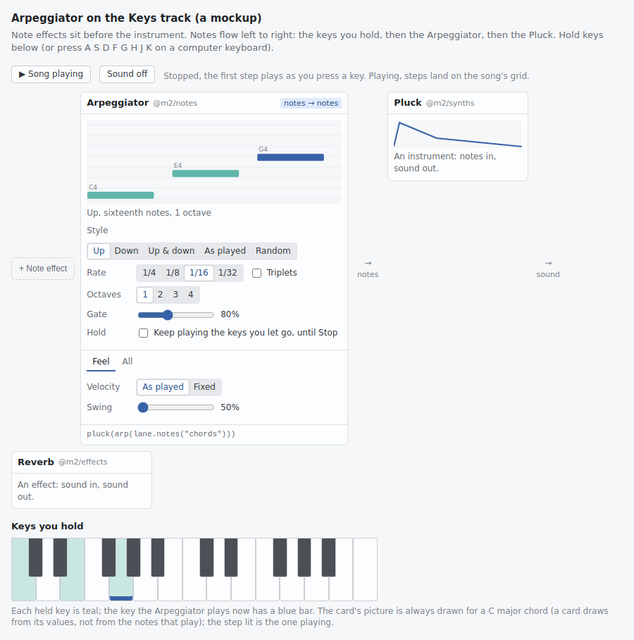

# Sounds that make notes: note effects

| | |
|---|---|
| **Status** | **Accepted** 2026-11-07: the owner said yes to D1 to D13 as recommended, and asked for it as simple as it can be; so the Arpeggiator has six controls, not eight (§7.1). Revised after the skeptic's review (E1 to E19, answered in §12). Nothing here is built. |
| **Written** | 2026-11-07, from `main` at `c653658c` |
| **Serves** | gap #16 (an arpeggiator, scales in code). It touches gap #24 (recording the wheels and the pedal), the Deferred row for event outputs ([ABI-2](../../architecture.md#kernel-abi-reservations)) and the `std/gen` tools [song-as-program.md](../../song-as-program.md) designs |
| **Mockup** | [a picture](images/mockup.png) of the Arpeggiator's card before a Pluck. The page it was taken from is kept outside the repo, on the maintainer's server (`$SCRATCH/events-note/mockup.html`, [paths](../README.md#paths-in-these-notes)). |

**In short**
- **Today notes go straight from a lane to an instrument.** Nothing can stand between them. So music2 has no arpeggiator, no chord tool, no note echo and no scale helper. Every DAW a pop producer uses has them.
- **A note effect takes notes in and gives notes out.** It sits before the instrument on a track's chain: keys → Arpeggiator → Chord → Pluck → Reverb. You add it from **+ Note effect**, as you add an effect after a sound.
- **It plays as the song plays**, to the sample, so an arpeggiator follows the keys you hold on a MIDI keyboard. Its steps come from the song's position, never from what it played before. So playing the song from any bar sounds like the export at that bar.
- **It runs where the notes lanes already run**: in the pass before the rest of the song, right after its lane. Every instrument still reads "a lane". That keeps the core change small (§3, option B′).
- **What the core gains, counted from the code (§6):** a kernel may give notes (the shape kernel ABI v1 reserved), one new kind of lane slot that runs it, a guard so no note or pedal ever hangs, the song's tempo as a signal, and the editor learning a third kind of sound. No new std kernel and no new route.
- **What it can't do yet:** a note effect's knobs can be turned and automated, but not moved by an LFO or by audio (a drum trigger from a kick). That needs note effects inside the song's graph (option B), a later step that changes no kernel.
- **Every note effect is a pack.** The first, `@m2/notes`, has four: **Arpeggiator**, **Chord**, **Note echo** and **Scale**.
- **Generators that write notes** (a Euclid rhythm, a chord progression) are something else: TypeScript **tools** that write notes into clips, where you see and edit them. song-as-program.md designs them as `std/gen`. They need no engine change, and come later in a note of their own.

## Words used here

| Word | Meaning |
|---|---|
| **Note effect** | A sound that takes notes and gives notes, before the instrument. Ableton calls these MIDI effects, Logic MIDI FX, Bitwig Note FX. |
| **Arpeggio** | A chord played one note at a time, in a pattern, over and over. An **arpeggiator** makes one from the keys you hold. |
| **Held notes** | The notes that are on right now: a chord in a clip, or keys you hold down. |
| **Step** | One note of an arpeggio. The **rate** is how long a step is: 1/16 is a sixteenth of a bar, a quarter of a beat. |
| **Gate** | How long each step sounds, as a share of the step: 50% is short and choppy, 100% joins them. |
| **Note echo** | Each note played again, later and quieter, a few times. A delay, but of notes rather than sound. |
| **Kernel** | Sound code compiled to WebAssembly, which runs as the song plays ([kernel ABI](../../kernel-abi.md)). |
| **Event** | One message in a stream of notes: a note starts (On), a note ends (Off), or a controller moves (the pedal, the wheels) ([RENDER-14](../../architecture.md#events)). |
| **Lane pass** | The part of each block, before the song's graph runs, where each notes lane fills its buffer from its clips and the keys played live ([RENDER-12](../../architecture.md#events)). |
| **Tool** | TypeScript from a pack that reads notes and writes new ones into a clip, once, when you use it. Not built yet ([song-as-program.md](../../song-as-program.md)). |
| **MPE** | A way for a keyboard to bend or press each note of a chord on its own. Later (D11). |

## 1. What is missing, and why it matters

- A pop producer's synth part is often a held chord turned into a pattern: the arpeggio in a dance-pop chorus, a pluck that repeats each chord in sixteenths. Today you must draw every one of those notes.
- A beginner can't play chords well. A Chord effect plays a whole chord from one key. A Scale effect makes every key you press fit the song's key, so no note is wrong.
- What music2 has already:

| Built | Where | What it gives |
|---|---|---|
| One event type for every source of notes | [RENDER-12, RENDER-14](../../architecture.md#events) | Clips, live keys, audition and the pedal all reach instruments as one stream of events, stamped to the sample. |
| Kernels that hear notes | [ABI-8, ABI-9](../../architecture.md#kernel-abi-reservations) (track `events`) | A kernel may take a lane's notes each block. No std or pack kernel uses it yet. |
| Kernels that give notes | [ABI-2](../../architecture.md#kernel-abi-reservations); `docs/kernel-abi.md:251` | **Reserved, not built.** The shape is fixed: the same header and 24-byte events as an input. `KernelSig::parse` refuses it today (`core/ir/src/sig.rs:123-126`). |
| A node whose output is notes | the note delay ([RENDER-18](../../architecture.md#latency); `core/runtime/src/lib.rs:303-310`, `:1240-1249`) | A precedent: notes can already come from a node, not only a lane. Option B (§3) would build on it. |
| Scales, the song's key | [NOTE-1 to NOTE-9](../../architecture.md#notes-and-scales), [VOX-10 to VOX-13](../../architecture.md#the-songs-key) | Thirteen scales in one table; chord stamps and grooves in the roll; `time.key`, the key as a set of 12 notes a kernel reads, which changes with no rebuild. |
| `std/gen`, `std/edit` tools | [song-as-program.md](../../song-as-program.md) | **Designed, not built**: "pure TypeScript functions from packages that take data and return Tx ops"; `euclid`, `arp`, `chords`, `scale`, `strum` as "generators that output lane data". |

How notes reach a sound today:

| Step | Where | What happens |
|---|---|---|
| 1 | the lane pass, `Renderer::pre` (`core/runtime/src/lib.rs:3422-3443`) | Each block, before the graph runs, each notes lane's `NoteScheduler` (`core/runtime/src/sched.rs`) fills its buffer from its clips, on one thread, in slot order: an On or Off at its exact frame. Live keys and audition join at the block's first frame ([MON-7](../../architecture.md#monitoring-overlays-and-mute-in-song)). Note ids come from one counter, `next_note` (`lib.rs:3435`), so they are the same on any number of threads. |
| 2 | the checker (`core/ir/src/check.rs:1097`, `:1099`, `:1156`) | A plugin's `notes`, a kernel's `events<note>` input and a `poly` must each read **a notes lane, straight** (or the note delay the latency planner put before one). |
| 3 | `PolyNode` and `PluginNode` (`lib.rs:686`, `:905`) | Each holds the lane slot it reads, and reads it during the graph with no edge to it, since the lane pass already ran (`Exec::reads`, `lib.rs:1232-1249`). |
| 4 | recording (`crates/server/src/graph/record.rs`) | A take records the keys as they were played, before any sound. |

So the missing piece is **something that turns notes into other notes**. The question is where it runs.

## 2. What other DAWs and code-first tools do

Read on 2026-11-07. "Snippet" marks a fact taken from a search result because the page itself would not load; those are weaker, and no decision rests on one alone.

### 2.1 DAWs: note effects that play

| Product | What it has | What we learn | Source |
|---|---|---|---|
| **Ableton Live 12** | MIDI effects: Arpeggiator, CC Control, Chord, Note Length, Pitch, Random, Scale, Velocity. Note Echo is a Max for Live device. They chain, and MIDI Effect Racks run chains side by side. | "First MIDI effects, then an instrument, and finally audio effects": what is left of the instrument is notes. | [MIDI effect reference](https://www.ableton.com/en/live-manual/12/live-midi-effect-reference/), [instruments and effects](https://www.ableton.com/en/live-manual/12/working-with-instruments-and-effects/), [racks](https://www.ableton.com/en/live-manual/12/instrument-drum-and-effect-racks/), [Max for Live devices](https://www.ableton.com/en/live-manual/12/max-for-live-devices/) |
| | Arpeggiator: 18 styles (Up, Down, UpDown, Play Order, three kinds of Random…), rate synced or in ms, gate as a % of the rate (over 100% overlaps), steps that transpose, **Hold**, **Retrigger** Off / Note / Beat, velocity decay, groove. Chord: up to six added pitches, ±36 semitones, and a strum of up to 400 ms. Scale: a note matrix (13 × 13 in the manual), or the clip's scale. | Many styles, but a beginner uses four or five. Retrigger and Hold decide when a pattern starts and stops. | [MIDI effect reference](https://www.ableton.com/en/live-manual/12/live-midi-effect-reference/), [Live 11's, with every style](https://www.ableton.com/en/live-manual/11/live-midi-effect-reference/) |
| | The scale is set **per clip**; Scale, Arpeggiator, Pitch, Random and Chord can follow it. | music2's key is the song's, in one place ([VOX-10](../../architecture.md#the-songs-key)): simpler. | [Editing MIDI](https://www.ableton.com/en/live-manual/12/editing-midi/) |
| **Logic Pro** | MIDI FX: Arpeggiator, Chord Trigger, Modifier, Modulator, Note Repeater, Randomizer, Scripter, Transposer, Velocity Processor. The Arpeggiator plays Up, Down, Up/Down, Outside-in, As played…; rates 1/4 to 1/32, triplets, dotted; it stops when you let go unless Latch is on; one key held is repeated. | The same set as Ableton's, under other names: it is what a producer expects. | [MIDI plug-ins](https://help.apple.com/logicpro-effects/mac/10.2/en.lproj/lgcec21fdd03.html), [Arpeggiator](https://help.apple.com/logicpro-effects/mac/10.2/en.lproj/lgce129c3fbe.html) (both the 10.2 manual, 2015) |
| | **Scripter**: JavaScript, called per event and once per block (`ProcessMIDI`, which Apple names as the place for "sequencers, arpeggiators, and other tempo-driven MIDI effects"). With timing on, each block knows its start beat and the tempo, and an event carries its beat position. | Code-written note effects are loved, and the model is **block by block, placed by beat**: what a music2 kernel does with `time.beats`. | Apple: [ProcessMIDI](https://support.apple.com/guide/logicpro/processmidi-function-lgce225e4d89/mac) (snippet: its body didn't load), [TimingInfo](https://support.apple.com/en-gb/guide/logicpro/lgcee186be46/10.7/mac/11.0), [beat positions](https://help.apple.com/logicpro/mac/10.4.5/en.lproj/lgce8eb55106.html) |
| **Bitwig Studio** | About 25 Note FX: Arpeggiator, Echo, Multi-note (a chord of up to 8), Key Filter, Latch, Note Length, Quantize, Strum, Harmonize… Per-note expressions (pressure, timbre, micro-pitch) live in clips. | **Quantize can only make notes later**, never earlier, because it runs live; its "forgiveness" lets a slightly late note through at once. The same holds for an arpeggiator's first step (§5). | [Note FX](https://www.bitwig.com/userguide/latest/note_fx), [note events](https://www.bitwig.com/userguide/latest/working_with_note_events/) |
| **FL Studio** | An arpeggiator in every channel's settings. VFX note effects (Key Mapper, Keyboard Splitter, Sequencer) only inside Patcher. | A built-in arp per channel is easy to find; note effects hidden in a patcher are not. FL has no chain of note effects before the instrument. | [Channel settings](https://www.image-line.com/fl-studio-learning/fl-studio-online-manual/html/chansettings_misc.htm), [VFX Sequencer](https://www.image-line.com/fl-studio-learning/fl-studio-online-manual/html/plugins/VFX%20Sequencer.htm) |
| **Max for Live**, **Reaper JSFX** | A MIDI effect reads every event and must send on whatever should pass (`midiout`; `midisend` with a sample offset in the block). One that forgets drops it. | Passing the pedal and the wheels on is the effect's job; music2's kit makes it one line, and the guard covers the rest (§6.4). | [Max MIDI effects](https://docs.cycling74.com/legacy/max8/vignettes/live_midieffects), [JSFX MIDI](https://www.reaper.fm/sdk/js/midi.php) |

Not verified from a primary page: whether Ableton's arpeggiator waits for the grid before its first step (only forum posts say so). §5's rule doesn't rest on it.

### 2.2 DAWs: tools that write notes

| Product | What it has | Source |
|---|---|---|
| **Ableton Live 12, MIDI Tools** | Transformations (Arpeggiate, Strum, Ornament, Chop…) and Generators (Rhythm, Seed, Stacks, Euclidean) in the clip view. They **replace the clip's notes**, and follow the clip's scale. Max for Live tools get the clip's notes as a list and give a list back. | [MIDI Tools](https://www.ableton.com/en/live-manual/12/midi-tools/), [Max MIDI Tools](https://docs.cycling74.com/max8/vignettes/live_miditools) |
| **FL Studio, piano roll scripts** | Python scripts that add, change and delete a clip's notes, with a dialog of controls and a preview. | [Piano roll scripting](https://www.image-line.com/fl-studio-learning/fl-studio-online-manual/html/pianoroll_scripting_api.htm) |

Ableton has both kinds and keeps them apart: effects that play, and tools that write. music2's `std/gen` and `std/edit` are designed as the second kind (option A, §3).

### 2.3 Plugin standards: how a note travels

| Standard | What a note is | Source |
|---|---|---|
| **CLAP** | Events carry a sample offset in the block and come **sorted**; a plugin's output must be sorted too. A note has a `note_id` (or −1), a port, a channel, a key and a velocity 0 to 1. Note expressions (volume, pan, tuning, vibrato, expression, brightness, pressure) are addressed to one note. A note-effect plugin has a note input port and a note output port. | [events.h](https://raw.githubusercontent.com/free-audio/clap/main/include/clap/events.h), [note-ports.h](https://raw.githubusercontent.com/free-audio/clap/main/include/clap/ext/note-ports.h) |
| **VST3** | A note on has a pitch, a tuning in cents, a velocity, and a `noteId` that note expressions use to find their voice. | [NoteOnEvent](https://steinbergmedia.github.io/vst3_doc/vstinterfaces/structSteinberg_1_1Vst_1_1NoteOnEvent.html), [note expressions](https://steinbergmedia.github.io/vst3_doc/vstinterfaces/ivstnoteexpression_8h.html) |
| **MPE** | One sounding note per MIDI channel, so each has its own bend (±48 semitones by default), pressure and timbre (CC 74). | [Roger Linn Design](https://www.rogerlinndesign.com/support/support-developers-how-to-add-mpe) |

music2's `Event` ([RENDER-14](../../architecture.md#events)) already has these parts: a frame in the block, an id, a pitch, a velocity, and room for per-note expression. A note effect needs no new note type.

### 2.4 Code-first music

| Tool | How notes are made | When | Source |
|---|---|---|---|
| **TidalCycles, Strudel** | A pattern is a **function of time**: asked for a span, it gives the events in it. A scheduler asks for the next slice each tick and plays it about 100 ms later. | ahead, any span in any order | [Tidal](https://tidalcycles.org/docs/innards/what_is_a_pattern), [Strudel](https://strudel.cc/technical-manual/patterns/), [its scheduler](https://codeberg.org/uzu/strudel/raw/branch/main/packages/core/cyclist.mjs) |
| **SuperCollider** | A pattern describes; a **stream** runs it, one step after another, with state. Sent 0.2 s ahead; live input uses no latency. | ahead, step by step from the start | [Patterns](https://doc.sccode.org/Tutorials/A-Practical-Guide/PG_01_Introduction.html), [Pbind](https://doc.sccode.org/Classes/Pbind.html), [timing](https://docs.supercollider.online/Guides/ServerTiming.html) |
| **Sonic Pi** | `live_loop`s run code in logical time, scheduled ahead; `chord(:E3, :minor)` is a list; random is seeded, so every run sounds the same. | ahead, step by step | [core.rb](https://github.com/sonic-pi-net/sonic-pi/blob/dev/app/server/ruby/lib/sonicpi/lang/core.rb), [randomness](https://github.com/sonic-pi-net/sonic-pi/blob/dev/app/web/web/data/tutorial/en/04-Randomisation.json) |

Two lessons. A pattern that is **a function of position** (Strudel) can be asked about any moment and gives the same answer: §5 makes the arpeggiator one. A stream with running state (SuperCollider) depends on where it started: that is what §5 avoids.

### 2.5 What the research decides

| Finding | So music2 |
|---|---|
| Ableton, Logic and Bitwig put note effects before the instrument, in the same chain (FL Studio keeps its arp in the channel's settings) | does too (D2) |
| Arpeggiator, Chord, Scale, an echo of notes, Random, Velocity and Note length are the common set | starts with the first four (D3) |
| Ableton keeps "effects that play" and "tools that write" apart, and both are loved | builds effects that play now; generators are tools, later (D9) |
| Logic's Scripter places notes by beat, block by block | a note effect reads `time.beats` each block, to the sample |
| A live effect can only delay a note, never play it early; Bitwig forgives a slightly late one | the arpeggiator catches a key pressed just after a step (D5) |
| Max for Live and JSFX drop what an effect doesn't pass on | the kit passes controllers on in one line, and the guard ends what a kernel leaves on (§6.4) |
| A pattern as a function of position answers the same at any moment (Strudel); random is repeatable from a seed (Sonic Pi) | the arpeggiator's step and its random choice come from the song's position and a seed (§5) |

## 3. Where notes are made: the options

| | **A. Tools at edit time** (song-as-program's `std/gen`) | **A2. An instrument that arpeggiates itself** | **B. Note effects in the song's graph** | **B′. Note effects in the lane pass** |
|---|---|---|---|---|
| What it is | Pack TypeScript reads a clip's notes and writes new notes into a clip, once, when you use it | A pack instrument whose own kernel takes its notes (ABI-8, built) and plays them as an arpeggio | A kernel that gives notes is a node of the graph; any notes input may read it | A kernel that gives notes runs in the lane pass, right after its lane; its output is one more lane slot |
| Follows keys held live | **No** | Yes, in that instrument only | Yes | Yes |
| Before **any** instrument, plugins too | n/a | **No**: each instrument would build its own, and Chord or Scale couldn't be shared | Yes | Yes |
| Notes you see and edit in the roll and the beat grid | **Yes** | No | No (Bake later) | No (Bake later) |
| Its knobs moved by an LFO or by audio (a drum trigger from a kick) | n/a | Yes | Yes | **No**: knobs, choices, the song's time and automation lanes only |
| Export = playback | Yes (it is data) | as any instrument | Yes, from the start | Yes, from the start, and at any bar with §5's rules |
| What the core gains | the tool runner: pack code run at edit time, giving Tx ops (not built; its own note) | **nothing** | B′'s, and: notes as graph edges, consumers that read a node, ids handed out on parallel threads, release when a source instance changes, a kernel consumer's shape holding its source (§6.9) | §6: one ABI shape, one lane-slot kind, the guard, `time.tempo`, the editor's third kind of sound |
| Ableton's MIDI effects it makes possible as packs | none (Live 12's MIDI Tools instead) | an arpeggiator glued to one sound | all of them | all of them: Arpeggiator, Chord, Scale, Random, Velocity, Note Length, Pitch, and Note Echo. CC Control needs a kernel that gives controllers, which the same shape allows later |

**A** is right for generators (a Euclid rhythm, a chord progression, "humanize this"): the notes land where the roll, the beat grid and agents see them, and a beginner can click one off. It can't follow a key played live. Agents can already do it today with no change: compute the notes in TypeScript and write them with the clip gestures (`m2 call`, [WRITE-10](../../architecture.md#the-two-write-primitives)).

**A2** needs no core change, and a pack could ship a self-arpeggiating synth tomorrow. It fails the owner's ask: an Arpeggiator added from + before *any* instrument, a plugin's too, and a Chord or Scale that every sound shares.

**B** and **B′** give the same note effects, with the same kernels and the same ABI shape. B′ keeps every consumer reading "a lane", so the checker's three rules, the graph's edges, the partitions across threads, the note ids and the release of a kept instrument all stay as they are (§6.9 counts what B would add). What B′ gives up is a note effect moved by audio or by a signal of the graph. None of the four first effects needs that.

**Recommendation:**
- **Now: B′**, the smallest core change that lets an arpeggiator follow keys held live, before any instrument.
- **Later: A**, the `std/gen` and `std/edit` tools, in a note of their own (D9). Generators write notes you can see; they are not note effects.
- **Later, when someone needs it: B**, for a note effect moved by an LFO or by audio. The kernels don't change; only where they run.

## 4. How it feels

### 4.1 On the track

```
keys you hold ─▶ [Arpeggiator] ─▶ [Chord] ─▶ [Pluck] ─▶ [Reverb] ─▶ mixer
                 note effects                instrument   effects
```

- **Note effects sit before the instrument**, left of it in Device, in the order the notes pass through them. A small "notes" arrow joins them; the instrument's card is where notes become sound.
- **+ Note effect** sits before the first card, as **+ Effect** sits after the last. It lists note effects only (a component that takes notes first and gives notes, §6.6).
- ⋯ on a note effect's card has what an effect's has: **Bypass** (the notes pass through it unchanged), **Move left / right**, **Remove**.
- Each card is the cards2 frame ([cards2](../cards2/design.md) §3): a face with its picture and its few knobs, a tab, and All.



### 4.2 In the song's code

A note effect is a function from notes to notes, so the code reads inside out, as effects do:

```ts
import { track } from "@m2/core";
import { pluck } from "@m2/synths";
import { arp } from "@m2/notes";

// Hold a chord (or draw one in "chords"): its notes play one at a time, a sixteenth each, up two octaves.
export default track("keys", { name: "Keys" }, ({ lane }) =>
  pluck(arp(lane.notes("chords"), { rate: "1/16", octaves: "2" })),
);
```

```ts
// One finger plays a whole chord of the key; Scale first, so a wrong key can't happen.
pad(chord(scale(lane.notes("keys")), { shape: "7th" }))
```

```ts
// One arpeggio, two sounds: notes are a value, so they can feed two instruments.
import { sum } from "std/math";
const notes = arp(lane.notes("chords"), { style: "updown" });
return sum(pluck(notes), synth.pad(notes));
```

```ts
// Automated like any knob: a lane on the timeline makes the steps longer through the chorus.
pluck(arp(lane.notes("chords"), { gate: lane.control("arp-gate", "scalar", 0.8) }))
```

When you add one with **+ Note effect**, the app writes the same code: it wraps the instrument's notes, `pluck(lane.notes("chords"))` becomes `pluck(arp(lane.notes("chords")))`, one undo step. Nothing about it is hidden state.

### 4.3 Playing it live

- Hold keys on a MIDI keyboard, or the computer's keys, on the track: the arpeggiator plays them. Let go and it stops, unless **Hold** is on.
- A key clicked in the roll (audition) plays through it too: audition joins the lane as live keys do.
- **While the song plays**, steps land on the song's grid, so the arpeggio is in time with the drums. A key pressed just after a step still plays that step at once (§5).
- **While the song is stopped**, the first step plays as you press the key, and the next ones follow at the song's tempo (D4).
- **Stop** stops a held arpeggio too (D7).
- It adds no delay: a key's notes come out in the block it goes in. (Live keys join a lane at the next block's first frame, about 2.7 ms, as they do today.)

### 4.4 Recording, and keeping what it played

| You want | You do | What happens |
|---|---|---|
| Record a part with the arp on | **Record**, as now | The take holds **the keys you pressed**, not the arp's notes (D6). Playing it back, the arp plays them again, so you can still change its rate. |
| Keep the arpeggio itself, to edit its notes | **Bake to notes** (later, §8 track 5) | Like Bounce ([RENDER-40](../../architecture.md#bounce-to-audio)): a new track plays the same instrument from the baked notes, and the track you baked is muted, its chords and note effects kept, so you can go back (D10). |

### 4.5 What an agent sees

- **The code**: `arp(lane.notes("chords"), { rate: "1/16" })` says it all, and the editor's types check it.
- **`m2 graph`** and `GET /api/graph`: a note effect is a card like any other, with its values, its face and its tab, printed in the chain's order before the instrument, marked as taking and giving notes.
- **`m2 listen`** hears it, as it hears any sound.
- **The song's `AGENTS.md`** (`templates/song-agents.md`) gains a line: note effects go before the instrument, and a pattern an agent wants to see in the roll is notes written into a clip, not a note effect.

## 5. How the Arpeggiator decides what to play

Each rule is a function of the song's position and the notes held, never of what the arpeggiator did before. So the same bar sounds the same live, after a Stop, after a seek, on each lap of a loop, and in the export.

| Rule | Exactly |
|---|---|
| **Held notes** | The notes on now in its input, after the block's events at this frame are applied (Offs, then Ons). |
| **Order** | By `style`: by pitch for Up, Down and Up & down (the top and bottom once each turn); by the order they started for As played (notes that start on one frame, by pitch); then `octaves` times, an octave higher each time. |
| **Step index** | While the song plays: `n = floor(beats / rate)`, the step of the song's grid the frame is in (a sixteenth is a quarter of a beat; a T rate two thirds of its plain one). |
| **Retrigger** | The pattern restarts with each new note held: when a note joins the held notes, its step is step 0. A chord drawn on the beat starts its pattern on that beat, every time, from any bar. Not a knob. |
| **Which note** | The `(n − n₀) mod L`th of the order, where `n₀` is the step the pattern restarted on and `L` its length. |
| **Catch** | A note that joins within a quarter of a step after a grid line (and at least 2 frames) plays that step at once, at its own frame. Later than that, it waits for the next step. This forgives a late finger, and the frame or so by which `time.beats`, a 32-bit number, can be off late in a long song (`core/runtime/src/lib.rs:3347`). |
| **Stopped** | With no transport moving, the pattern runs from the first key pressed, one step each rate at `time.tempo` (D4). |
| **Play pressed while keys are held** | The pattern restarts on the grid: its first step at the first grid line at or after where the song starts (within the catch, at once). |
| **Gate** | Each step's note sounds `gate` × the step, from the step's start: under 1 is choppy, over 1 overlaps the next. |
| **Swing** | The second step of each pair later, as the roll's swing ([NOTE-7](../../architecture.md#notes-and-scales)): 50% straight, 66% a shuffle. |
| **Velocity** | The velocity of the note it plays. |
| **Random** | The step's note is `hash(seed, n − n₀) mod L`: no running random number, so a step plays the same note every time the song passes it. |
| **Hold** | Latches only keys played live: let go, they keep playing until a new key is pressed. Stop, Play and a seek let go of it. A clip's chord always ends with its notes, so an export never plays a latched chord to its end. |
| **Controllers** | The wheels and the pedal are passed on as they come (the kit's `pass` in one line). |
| **One key held** | Repeated at the rate (as Logic's): note repeat. |

So: from any bar, playback sounds like the export at that bar, as std's drums and LFOs do ([RENDER-6](../../architecture.md#live-engine-and-its-two-clocks)). The one exception is shared by every instrument: a note that started before the place you play from isn't chased ([RENDER-26a](../../architecture.md#plans-data-and-arrangement-swaps)), so a chord already sounding there starts at its next new note. Keys played live never reach an export.

Note echo follows the same idea: its echoes are worked out from each note's start and the beat, and Stop or a seek ends them (the guard, §6.4).

## 6. What the core gains, counted from the code

This is option B′. Line numbers are at `c653658c`.

| # | Layer | Gains | Where | Count |
|---|---|---|---|---|
| 1 | Kernel ABI | **A kernel may give notes**: an output of kind `events<note>`, ABI-2's reserved shape (§6.1) | `core/ir/src/sig.rs:123-126` (accept it); `core/runtime/src/sandbox.rs:422-484` (place its header as an input's is); the kit's `Io::give`, beside `Io::events` (`std/kernels-src/kernel/src/lib.rs:446`) | **1 reserved shape built**, ABI-5's rule 4 restated for it |
| 2 | Manifest | `fan`: how many notes a note effect may give for each note in, 1 to 8 (Chord 4, Note echo 8), which sizes its room (§6.4) | `KernelDecl` (`core/runtime/src/packages.rs`) | **1 field** |
| 3 | IR and the checker | **A note effect node**: a kernel with a notes output, at a module's top level, whose notes come from a lane or another note effect, and whose other inputs are only constants, knobs, choices, `time` and control lanes. Refused inside a `poly`, through a `feedback`, and as a module's export. The three "straight from a notes lane" refusals read "a lane, or a note effect over one" | `core/ir/src/check.rs:1097`, `:1099`, `:1156`, and one new check | **1 new check, 3 refusals widened** |
| 4 | Runtime: the lane pass | **One more kind of lane slot**, a note effect's: run in the lane pass after the block's times (`Renderer::block` moves before the lanes, `lib.rs:3326`), after its source, in slot order on one thread. Its control lane inputs are read from their data there, as their own node reads them. Every consumer reads it as a lane | `LaneSlot` (`core/runtime/src/plan.rs:459-464`) and its build (`plan.rs:565-600`); `Renderer::pre` (`lib.rs:3422-3443`); `events_room` (`lib.rs:120`) | **1 slot kind** |
| 5 | Runtime: the guard | Checks, sorts and numbers what a kernel gives, keeps its sounding notes and its pedal and wheels, and ends them (§6.4). Ids from the one counter, `next_note` (`lib.rs:3435`) | a new file beside `sched.rs`; `gates_are_owned` and `live_notes` (`lib.rs:3815-3840`) each get one more arm | **1 part** |
| 6 | Runtime: activation | A note effect's slot is kept across plans by its address: its lane's, and each note effect's shape before it. A consumer whose slot address changed is released at entry by today's test (§6.5) | `notes_lane` (`core/runtime/src/keep.rs:144`) widened; the release test (`keep.rs:270-279`) unchanged; `NoteScheduler::take_state` (`sched.rs:456`) as the model | **1 function widened** |
| 7 | Time | **`time.tempo`**: the song's tempo where it is, in beats per minute, song time like `time.beats`. Needed only if D4 is yes; also gives a tempo-synced delay (no `@m2/effects` sound reads the beat or the tempo today) | `TimeOf` (`core/ir/src/lib.rs:383-392`), `Unit` (`core/ir/src/kind.rs:14`), the block's times (`lib.rs:3326-3350`) | **1 signal, 1 unit (`bpm`)** |
| 8 | SDK, `@m2/core`'s next minor | `time.tempo` and the unit `bpm`; a third kind of sound in `component()`: notes first and notes out is a note effect; `bypass` on a notes-to-notes call | `Time` (`core/script/sdk/core.ts:3104-3112`); `Unit` and `UNIT_NAMES` (`core.ts:8`, `:2123`); the instrument check (`core.ts:2399-2409`); `Bypassable` (`core.ts:1843-1848`), `bypassable` (`:2567`), its error (`:2756`) | **1 word, 1 unit, 2 rules** |
| 9 | Editor (Rust) | The third kind of sound in four places: `Descriptor::is_note_effect` beside `is_effect` and `is_instrument`; the library's kinds; the pack check and its test song; previews (a note effect is previewed through a plain pluck) | `core/script/src/component.rs:300-314`; `crates/editor/src/library.rs:364-390`; `crates/editor/src/packs.rs:356`, `:489-496`; `crates/editor/src/library/preview.rs:167` | **1 kind, in 4 places** |
| 10 | Editor: writes | + Note effect wraps the instrument's notes; bypass, move and remove on a note effect | `add_effect` (`crates/editor/src/effect.rs:315`), `bypass` (`:558`), `reorder` (`:692`) | **1 write kind** |
| 11 | Window | Device shows note effects left of the instrument, with + Note effect. The cards use the cards2 frame and its existing live layers (the arp's step meter, [ABI-13](../../architecture.md#kernel-abi-reservations)) | `web/` | **1 change to the chain** |
| 12 | Routes, std | none | | **0** |

Everything else is in a pack: `@m2/notes`, with its own kernels (`packs/@m2/notes/kernels-src`, built by `std/build.sh`, [ABI-10](../../architecture.md#kernel-abi-reservations)).

What stays as it is, because consumers still read a lane: `PolyNode` and `PluginNode`'s lane slot (`lib.rs:686`, `:905`), `give` (`lib.rs:303-310`), the graph's edges (`Exec::reads`, `lib.rs:1232-1249`), the partitions across threads (`core/runtime/src/parts.rs`), the pedal and key counts of the voices ([RENDER-38, RENDER-39](../../architecture.md#voices)), and the kit finder (`crates/editor/src/kits.rs:171-177`; KIT-1 is unchanged, §9).

### 6.1 A kernel may give notes

- A kernel's manifest may list an output of kind `events<note>`: `outputs = ["out: events<note>"]`. Its one entry in the port table is the address of a header `{count: u32, cap: u32, events: address}`, then `cap` events of 24 bytes, RENDER-14's `Event` as `docs/kernel-abi.md` lays it out. The host places them at birth, in the state's own block, and writes `cap`. Before each call it sets `count` to 0; the kernel writes its events and sets `count`.
- **The host trusts nothing in the header.** It reads `min(count, its own cap)` events from the address it placed, never the header's `cap` or `events`, which the kernel could overwrite.
- **ABI-5's rule 4**, "write every frame of every output", is restated for it: set `count`, and write events only below `cap`.
- Like a kernel that takes notes, it runs on whole blocks (`from` 0, `to` 128), so an event's frame is also its place in the call's other inputs.
- **It keeps kernel ABI v1** ([ABI-3](../../architecture.md#kernel-abi-reservations)): the shape was fixed among v1's reservations, and a module with no notes output sees nothing new.
- The same kernel would run unchanged in option B's graph later: only where the host calls it would move.

### 6.2 The lane pass, with note effects

```
each block, on one thread, before the graph:
  the block's times
  lane "chords": its clips and live keys        → slot 4
    note effect arp   (slot 4 in)               → slot 9
      note effect chord (slot 9 in)             → slot 10
  lane "bass": …
then the graph, on every thread: Pluck reads slot 10, as it reads any lane
```

- The kernels are small (an arpeggiator looks at a few events a block), but they run on one thread before the others start. Track 1 measures the pass with eight note effects against the block's budget.
- A pack's note effect has the same time limit as any pack's kernel ([ABI-6](../../architecture.md#kernel-abi-reservations)); `@m2/notes` is music2's own and runs without one ([ABI-11](../../architecture.md#kernel-abi-reservations)). One stopped for taking too long ([ABI-7](../../architecture.md#kernel-abi-reservations)) gives no notes from then on, and its guard ends what it had sounding.

### 6.3 Why TypeScript alone can't

- **Build code can't see notes.** A song's TypeScript runs once, when the song builds, and may not read the lanes ([RENDER-15](../../architecture.md#events)), so a note drawn in the roll is heard without a rebuild.
- **Build code can't see keys played live.** It has finished before you touch the keyboard.
- **A tool (option A) writes notes once.** It can't follow a key either.
- **Nothing that exists turns notes into other notes.** A `poly` turns notes into sound, and a kernel turns signals into signals; the only source of notes is a lane. An instrument can arpeggiate itself (A2), but then only itself.
- **TypeScript on the audio thread is no answer.** Logic's Scripter runs JavaScript there, but music2 runs pack code in a build sandbox with a garbage collector, and the audio thread must never wait ([RENDER-28](../../architecture.md#plans-data-and-arrangement-swaps)). Kernels are how music2 runs code as the song plays.

What stays TypeScript: every note effect's descriptor, card, pictures and words; tools and generators (option A, later).

### 6.4 The guard

A pack's kernel may be a stranger's code. A note it starts and never ends, or a pedal it presses and never lets up, would hang. So the host reads every note effect's output through a guard, which lives in its lane slot, allocates nothing, and keeps a fixed room:

| The kernel gives | The guard |
|---|---|
| events out of order | sorts them into RENDER-14's order (by frame; at one frame controllers, Offs, Ons) by counting into 128 frames × 3 kinds with a fixed scratch: one pass, stable, the same order for the same input |
| a frame outside the block, a kind it doesn't know, an On's pitch outside 0 to 127 or not a number, a velocity outside 0 to 1 | drops the event (an On's third value may be NaN: it means "no slide", `docs/kernel-abi.md:162`) |
| an On | gives it the next id from `next_note`, on the lane pass's one thread, keeping the kernel's own id beside it; an On whose kernel id is already sounding first ends the old one |
| an Off | sends it only for a note sounding from this kernel; drops it otherwise |
| the pedal or a wheel | keeps the latest it passed, as a lane does (`sched.rs:241`, `WHEELS`) |
| more notes sounding than its room | ends the oldest to make room, so a kernel that forgets its Offs keeps sounding rather than going silent |
| more events than its room | keeps the first ones |

**Rooms.** Each slot's room is its source's room × the kernel's `fan`: a lane's is sized to its data ([ABI-8](../../architecture.md#kernel-abi-reservations): 812 events and 256 sounding notes for most lanes). So a one-for-one effect (Scale) has all its lane's room, and never drops a note the instrument would have played without it.

**A drop is a fault.** Live, it is said once per plan, naming the sound and its pack ("Arp on Keys, from @alice/arp, gave notes music2 can't play; some were left out."). In an export it fails the render, naming the sound, as any fault that changes the sound does ([RENDER-1](../../architecture.md#offline)).

**It ends every note and lets the pedal up** (the pedal at 0 before the Offs, the wheels back at rest, as RENDER-36 does for a lane), at that frame, when:
- the song stops or jumps (a seek, a loop's wrap), as a lane does ([RENDER-9](../../architecture.md#seek-and-loop));
- **Stop is pressed while the song is already stopped**: a stuck arpeggio is one press away from silence;
- the kernel is reset (a panic, Stop All Sound), replaced by a new plan, or stopped for taking too long ([ABI-7](../../architecture.md#kernel-abi-reservations)).

So no note effect can leave a note or the pedal on past Stop, a seek, a reset or a replacement.

### 6.5 Activation and replacement

1. **A note effect's guard lives in its lane slot**, and the slot is kept across plans by its address: its lane's (`LaneAddr`), with the shape of each note effect from the lane to it. A kept slot keeps its kernel's state and its sounding notes, as a lane's scheduler does (`NoteScheduler::take_state`).
2. **A consumer whose slot address changed is released at entry**: its notes end and its pedal lets up. That is today's test, "its notes now come from another lane" (`keep.rs:273-279`), with the widened address. So replacing an arpeggiator (a new seed, another kernel) ends the notes of the instrument after it, which is kept.
3. **A note effect after a replaced one is new too**, since its address holds its source's. It loses its own state (a Chord after a replaced Arp starts clean).
4. **A replaced slot's notes end** at the activation's first frame, with the release of its consumers; a ghost reads nothing new.
5. **Bypass on or off** changes the chain, so it is an activation that ends the instrument's notes ([PKG-3](../../architecture.md#component-descriptors)'s bypass, widened to notes).

### 6.6 A note effect is a component

No new descriptor field: the types say what it is ([cards](../cards/design.md) §2, "one declaration").

| A component's first input | Its output | The editor calls it | Offered by |
|---|---|---|---|
| notes | audio | an instrument (today) | + Track, Change instrument |
| audio | audio | an effect (today) | + Effect |
| **notes** | **notes** | **a note effect** (new) | **+ Note effect** |

Its `editor.category` groups it in that list (Arpeggiator, Chords, Scales…), as categories group effects ([PKG-7](../../architecture.md#component-descriptors)).

### 6.7 Rules that change

The contract changes first, in each track. New rule ids are given out by the lead.

| Rule | Today | With note effects |
|---|---|---|
| [ABI-2](../../architecture.md#kernel-abi-reservations) | event outputs reserved | built (§6.1); `k_save`, `k_latency` stay reserved |
| [ABI-5](../../architecture.md#kernel-abi-reservations) | rule 4: write every frame of every output | and, for a notes output, set `count` and write only below `cap` |
| [ABI-8](../../architecture.md#kernel-abi-reservations) | a kernel's notes come straight from a lane | from a lane or a note effect over one |
| [ABI-11](../../architecture.md#kernel-abi-reservations) | music2's own packs run without a deadline | unchanged; `@m2/notes` is one of them |
| [RENDER-12](../../architecture.md#events) | a notes lane fills each buffer in the lane pass | and each note effect on it, after it, in the same pass |
| [RENDER-26a](../../architecture.md#plans-data-and-arrangement-swaps) | a scheduler owns its sounding notes; a consumer on another lane is released | a guard owns its own the same way; a lane's address includes its note effects |
| [RENDER-7](../../architecture.md#live-engine-and-its-two-clocks) | `time` reads beats, seconds, playing, key | and tempo, if D4 is yes |
| [PKG-3](../../architecture.md#component-descriptors) | `bypass` on an audio-to-audio call | and on a notes-to-notes call |
| [PKG-7](../../architecture.md#component-descriptors) | notes first is an instrument | notes first and notes out is a note effect |
| [NOTE-9](../../architecture.md#notes-and-scales) | "Not yet: an arpeggiator" | gone; the guide's [music basics](../../guide/music-basics.md) line too |
| [KIT-1](../../architecture.md#drum-kits) | a Drum fed by anything but its own lane is in no kit | unchanged (§9) |

### 6.8 Rules this note sets for the lead (not the owner's decisions)

- **The guard is required** for every note effect, std's and music2's own included (§6.4). It is a safety rule, like the time limit.
- **ABI-4's `const-events`** reserves a way for build code to put notes into the engine. Generators are tools (option A) and note effects are kernels, so nothing needs it: the lead may retire it, or leave it reserved and unbuilt.

### 6.9 What option B would add, for later

If a note effect must one day be moved by an LFO or by audio, it moves into the graph. On top of §6:
- notes as graph edges, so a consumer is ordered after its source (`Exec::reads`, `lib.rs:1232-1249`; `parts.rs`);
- consumers that read a node's output, not a lane slot (`lib.rs:686`, `:905`, `:303-310`);
- ids that are the same on any number of threads, handed out inside parallel partitions (for example, a fixed block of ids per note effect, set at plan time);
- release keyed on a source instance, not a lane (`keep.rs:273-279`), and a kernel consumer's shape holding its source's;
- `gates_are_owned` and `live_notes` (`lib.rs:3815-3840`) over node outputs.

The kernels, the ABI shape, the guard's rules and the cards stay as they are.

## 7. The first pack: `@m2/notes`

Four note effects, each a component in TypeScript over one kernel of the pack's own. Each choice is a control (a menu that changes while the song plays, with no rebuild, [CARD-10](../../architecture.md#kinds-of-values)), so an automation lane can move it.

### 7.1 Arpeggiator

```ts
export const arp = component(
  {
    id: "arp", label: "Arpeggiator",
    inputs: { notes: port.notes() },
    controls: {
      style: control.choice(["up", "down", "updown", "played", "random"], "up"),
      rate: control.choice(["1/4", "1/8", "1/8T", "1/16", "1/16T", "1/32"], "1/16"),
      octaves: control.choice(["1", "2", "3", "4"], "1"),
      gate: control.scalar(0.8).range(0.1, 2),
      hold: control.bool(false),
      swing: control.frac(0.5).range(0.5, 0.71),
    },
    settings: { seed: setting.int(1) },
    output: port.notes(),
    editor: {
      category: "Arpeggiator",
      views: { steps: stepsPicture() }, // drawn for a C major chord; its step lit by the kernel's `step` meter
      face: ["steps", "style", "rate", "octaves", "gate", "hold"],
    },
  },
  (notes: Events, { style, rate, octaves, gate, hold, swing, seed }: Params) =>
    kernel<EventsKind>(
      "@m2/notes:arp",
      { notes, beats: time.beats, playing: time.playing, tempo: time.tempo, style, rate, octaves, gate, hold, swing },
      { values: [seed] },
    ),
);
```

It plays by §5's rules. Its card:
- **The face** is the steps picture: the pattern drawn as short bars, low to high, **for a C major chord**, since a picture draws from the card's values and never sees the notes that play ([CARD-63](../../architecture.md#pictures-on-the-card)). The step playing now is lit by the kernel's meter `step` ([ABI-13](../../architecture.md#kernel-abi-reservations), a meter read by a live layer). Its words say what the values say: "Up, sixteenth notes, 2 octaves".
- The face's knobs: Style (a segmented control: five options), Rate, Octaves, Gate and Hold. Swing is under All. A rate with a T is a triplet. There is no velocity choice: each step plays as hard as its key was played (a Velocity note effect, §7.5, makes them alike).
- Drawing the notes actually held would need a live layer of notes, which pictures don't have; it waits for someone to miss it.

### 7.2 Chord

`chord(notes, { shape: "triad", inKey: true, inversion: 0 })`: each note you play becomes a chord.

- **Shape**: Octave, Fifth, Triad, 7th, sus2, sus4, add9 (`fan` 4).
- **In key** (on by default): built from `time.key`, the key's 12-note set ([VOX-12](../../architecture.md#the-songs-key)). The played note is first moved to the key's nearest note, a tie going down ([NOTE-3](../../architecture.md#notes-and-scales)); then the chord stacks every other note **of the key** from it (a triad is the 1st, 3rd and 5th notes of the key counted from it).
  - In the seven-note keys (major, minor, the modes, harmonic and melodic minor) this is exactly the roll's chord stamps ([NOTE-4](../../architecture.md#notes-and-scales)); a test checks the kernel against the stamps table for every such key and root.
  - In the pentatonic and blues keys it is not: the stamps build those from their major or minor and refuse some chords, but `time.key` is only a set of notes, which can't tell which major or minor, or which note is the blue one. Here the chord is stacked from the key's own five or six notes, and nothing is refused: a live effect must always play something (D8).
  - With no key, or a chromatic one (both 4095), and with **In key** off, the shapes are fixed: a triad is major, a 7th is a dominant 7th.
- **Inversion**: 0 to 3.
- The face: a small keyboard with the chord drawn on C, and its words ("A triad of the key").

### 7.3 Note echo

`echo(notes, { time: "1/8", repeats: 3, fall: 0.3, pitch: 0 })`: each note played again `repeats` times (up to 8, `fan` 8), `time` apart in beats, each `fall` quieter, and `pitch` semitones higher (+12 climbs by octaves). Echoes are placed from each note's start on the beat; stopped, they keep time by `time.tempo`. Stop and a seek end them. The face: the echoes drawn as fading bars.

### 7.4 Scale

`scale(notes, { shift: 0 })`: every note moved to the nearest note of the song's key, a tie going down, as Lock to key does in the roll. `shift` moves each note that many notes **of the key** up or down (+2 in C major turns C E G into E G B). With no key it plays notes as they are, and its card says "Set the key". The face: the twelve notes, the key's lit.

### 7.5 Later, as the pack's minors

| Note effect | Does | Ableton's |
|---|---|---|
| Random | moves some notes by chance (from `hash(seed, …)`), in the key | Random |
| Velocity | makes notes louder, softer, or more alike | Velocity |
| Note length | makes every note a set length | Note Length |
| Strum | spreads a chord's notes in time, low to high | Chord's strum |

## 8. Build order

Each track has a builder, a skeptic who attacks what it built, and the builder again, as in [Typed sounds](../cards/design.md) §11. The contract changes first in each.

| # | Track | Builds | Tests, by what they check | Size |
|---|---|---|---|---|
| 1 | `notes-out` (`core/ir`, `core/runtime`, the kit) | §6 rows 1 to 7: the notes output and `Io::give`, `fan`, the note effect node and its checks, the lane slot and the pass, the guard, activation, `time.tempo` in the IR and the renderer | with hand-written kernels in `core/runtime/src/tests/events.rs`: a note effect's notes reach a `poly` and a plugin to the frame; a chain of two; each guard row (order, bad events, unknown Offs, the oldest ended, a full room); a kernel that presses the pedal and is then stopped lets it up; Stop pressed while stopped ends its notes; a replaced note effect releases its kept instrument; the same bits on 1 to 7 threads; no allocation in the pass (`core/play/tests/no_alloc.rs`); a drop fails an export; live from 0 = offline; the pass's time with eight note effects | medium to large |
| 2 | `notes-sdk` (`core/script`, `crates/editor`) | §6 rows 8 to 10: `@m2/core`'s minor (`time.tempo`, `bpm`, the note-effect branch, bypass on notes); the Rust classifier in four places; + Note effect's wrap, bypass, move | the SDK's checks of a note effect's descriptor and calls; the library and the pack check list one; a wrap, a bypass and a move are each one undo step | medium |
| 3 | `notes-pack` | `@m2/notes` 0.1.0: the four kernels and their kit tests, the components, `examples/arp` in `renders.json`; the guide's page, NOTE-9's bullet and music-basics' line; `templates/song-agents.md`'s line | §5's rules each by a kernel test (catch, retrigger, Hold let go at Stop, random by step); Chord against the stamps for every seven-note key; the example's bits | medium |
| 4 | `notes-chain` (`web/`) | §4.1 and §7's cards: note effects left of the instrument in Device, + Note effect, the cards in the cards2 frame, the steps picture and its meter | `e2e` suites: add, bypass, move and remove a note effect; the card's face and tab | medium |
| 5 | later | **Bake to notes** (like Bounce, D10: a new track from the baked notes, the source muted and kept; one route, one command); **`std/gen` and `std/edit` as tools** (option A: the tool runner, in a note of its own, D9); **note repeat in a kit** (KIT-1, §9); **option B** (§6.9) when a note effect must follow an LFO or audio | | each its own |

Tracks 1 and 2 can start together, and the pack's kernel code (3) beside them against the reserved shape; 4 needs 1 and 2.

## 9. Not now

| What | Why later |
|---|---|
| Note effects on a Drum track **in a kit** (note repeat on the hats) | KIT-1 counts a Drum only when its notes come from its own lane. Widened, the beat grid and the pads would show the hits you wrote while you hear the repeats; Cut by ([KIT-27](../../architecture.md#drum-kits)) would cut at the written hits, not at each repeat; and a Scale or Chord would change which drum plays. Until those are decided, a note effect on a Drum takes it out of its kit, and the window says so. A Drum on a track of its own can have one. |
| Bake to notes | Not needed to use the four effects, and the take already keeps your keys (D6). Track 5, built like Bounce. |
| Generators (Euclid, patterns, chord progressions) | Tools that write notes you see (option A, D9), in their own note, with the tool runner. |
| Note effects moved by an LFO or by audio | Option B (§6.9). |
| A live picture of the notes held | Pictures draw from values; a live layer of notes would be a new one (§7.1). |
| Per-note bends and MPE | RENDER-14 reserves `NoteExpression`; a note effect can pass them on once keyboards send them. Recording them needs a format change ([gap #24](../../gaps.md)). D11. |
| CLAP plugins that are note effects | music2 reads a plugin's output events only for parameter gestures today. A plugin note effect would be one more kind of lane slot. D12. |
| A note effect reading another track's notes | Notes are a value inside a track (§4.2). Across tracks, a track would export notes: its own design. |
| A key that changes partway through the song | gap #16's own "Left". Scale and Chord follow `time.key`, so they will follow a changing key unchanged. |

## 10. Decisions for the owner

| # | Question | Recommended (all accepted, 2026-11-07) |
|---|---|---|
| D1 | Should the arpeggiator, chord tool, note echo and scale be **sounds that play** (they follow the keys you hold, and you can change them any time), rather than tools that write notes into a clip once? | **Sounds that play.** It is how Ableton, Logic and Bitwig do it, and the only way an arpeggiator follows a keyboard. |
| D2 | Should a note effect sit **before the instrument on the same track**, shown left of it, with its own **+ Note effect** button? | **Yes.** Notes go left to right, then sound does. |
| D3 | The first four: **Arpeggiator, Chord, Note echo, Scale**, in a new pack, `@m2/notes`. Right four? | **Yes.** Random, Velocity, Note length and Strum follow. |
| D4 | Should the arpeggiator **keep playing while the song is stopped** and you hold keys? It needs the song's tempo as a new signal, which a tempo-synced delay could use too. | **Yes.** You try ideas on the keyboard before you press Play. |
| D5 | If you press a key **just after** a step, should the arpeggio **start at once** (a little late) or **wait for the next step** (in time, but you hear nothing for a moment)? | **At once, if you are less than a quarter of a step late**; later than that, it waits. Your playing feels answered, and the arpeggio stays in time. |
| D6 | When you **record** with an arpeggiator on, should the take keep **the keys you pressed** or **the notes the arpeggiator played**? | **The keys you pressed.** You can change the arpeggio afterwards. Ableton and Logic do the same. |
| D7 | When you press **Stop**, should an arpeggio you are holding with **Hold** stop too? | **Yes.** Stop always means silence. Hold keeps playing the keys you let go of until you press new ones, Stop, or Play. |
| D8 | **Chord** builds its chords from the song's key: one finger on D in C major plays D minor. In a pentatonic or blues key, its chords come from the key's own five or six notes, so they can differ from the roll's chord stamps. Is that all right? | **Yes.** In the usual keys they are the same; in the others it still only plays notes of the key. |
| D9 | Should a **rhythm or chord generator** (Euclid, a progression) **write notes you can see** and edit in the clip, or **play notes you can't**? | **Write notes you can see.** A beginner can click one off, and an agent can read it. They come later, as tools. |
| D10 | Later, **Bake to notes**: should it keep your original track (muted, with its chords and note effects) so you can go back, as Bounce does? | **Yes.** Nothing you made is thrown away. |
| D11 | **Bending each note of a chord on its own** (MPE): now or later? | **Later** (gap #24). Note effects pass the wheels and the pedal on from the start. |
| D12 | **CLAP plugins that are note effects** (a plugin arpeggiator): now or when someone asks? | **When someone asks.** |
| D13 | For now, a note effect's knobs can be turned and drawn on the timeline, but **not moved by an LFO or by another sound** (a kick triggering notes). That keeps the core change smaller. All right for now? | **Yes.** None of the four needs it, and it can come later without changing them. |

## 11. The mockup

The [picture](images/mockup.png) shows the Arpeggiator before a Pluck and a Reverb. Its page lets you hold keys on a small keyboard, or the computer's keys, and hear and see the steps: the pattern is drawn for a C major chord, as the card can draw it, and the step playing is lit, as the kernel's meter would light it. It is a sketch of the card, not the window.

## 12. The review, answered

The skeptic's review of the first draft (`4ce848a0`) had 19 findings.

| Id | Finding | Answer |
|---|---|---|
| E1 | The core gain was undercounted | Agreed. §6 recounts it from the code, layer by layer, with file and line for each part, and lists what stays as it is. The In short says what the core gains in words. |
| E2 | Option A was set against a design music2 never had; tools and a no-core path were left out | Agreed. Option A is now song-as-program's `std/gen` tools, right for generators (D9, later); A2, the self-arpeggiating instrument, is weighed and fails "before any instrument"; agents can generate notes today with no change. Generators left the build order's kernels. |
| E3 | Export = playback fails for a stateful arpeggiator | Agreed. §5 makes the arpeggiator a function of position: step from `time.beats`, Retrigger on each new note, random from `hash(seed, step)`, Hold only for live keys and let go at Stop, Play and seek. |
| E4 | The guard left the pedal and wheels out | Agreed. The guard keeps the pedal and wheels it passed and puts them at rest wherever it ends notes; Stop pressed while stopped ends everything; a full room ends the oldest note rather than going silent (§6.4). |
| E5 | Activation and replacement were unclear | Agreed. §6.5 states five rules; in B′ they mostly fall out of today's lane-address release test, widened. |
| E6 | Fixed rooms broke "no event is left out"; the sort could be slow | Agreed. Rooms are the source's × the manifest's `fan`; the sort counts into frames × kinds in one pass; the NaN check is on the pitch only; a drop fails an export (§6.4). |
| E7 | Ids couldn't come from inside a partition | Answered by B′: the lane pass runs on one thread and takes ids from `next_note` in slot order. The 1-to-7-thread test is in track 1. |
| E8 | Chord in key can't match the stamps from `time.key` | Agreed. The chord stacks from the key's own notes: equal to the stamps in seven-note keys, different in pentatonic and blues, nothing refused (§7.2, D8). No root signal added. |
| E9 | Grid-only steps make a late key wait; `time.beats` in f32 can be a frame off | Agreed. A catch of a quarter step (at least 2 frames) plays a late key's step at once, which also absorbs the f32 error; steps are judged after the frame's events (§5). D5 asks it in plain words. |
| E10 | Hold and generators never stop | Agreed. Hold latches only live keys and is let go by Stop, Play and a seek (D7); a clip's chord ends with its notes, so an export ends; generators are tools now, not kernels. |
| E11 | Bake threw away the chords | Agreed. Bake moves to a later track and works like Bounce: a new track from the baked notes, the source muted and kept (D10). |
| E12 | The card can't show the held notes | Agreed. The steps picture draws a C major chord from the values, with the step lit by a meter; its words say only what the values say (§7.1). The mockup was changed to match. |
| E13 | Track 1 was too big; some changes had no track | Agreed. Track 1 is split into `notes-out` and `notes-sdk`; the docs lines and the song `AGENTS.md` line are in `notes-pack`; the missing tests are listed by what they check (§8). KIT-1 no longer changes now. |
| E14 | ABI rules an events output touches were missing | Agreed. ABI-5's rule 4 is restated, the host reads from its own address and its own cap, ABI-11's no deadline for `@m2/notes` is said, and notes through `feedback` or a module export are refused (§6.1, §6.7). |
| E15 | A smaller primitive exists: note kernels in the lane pass | Agreed, and it is now the recommendation (B′). B is kept for later, when a note effect must follow an LFO or audio (§6.9, D13). |
| E16 | Some decisions weren't the owner's, two were missing | Agreed. The guard and ABI-4 moved to rules for the lead (§6.8); D4, D5 and D10 are reworded; Stop and a held arpeggio (D7) and keeping your chords (D10) are asked; D8 has its pentatonic caveat; D13 asks the B′ trade-off. |
| E17 | `time.tempo` uncounted; not shown general; no Play handover | Agreed. It is counted (a word, a unit, the IR and the renderer), a tempo-synced delay is named as a second user, and §5 says how Play hands over to the grid. |
| E18 | KIT-1's widening had side effects | Agreed. KIT-1 is unchanged for now; its side effects are listed in §9 for when note repeat in a kit is wanted. |
| E19 | Weak sources and small slips | Fixed: weak sources are marked, Apple's Scripter pages are cited, Ableton's first-step behaviour is called unverified and no rule rests on it; FL Studio is no longer counted with "every DAW"; Scale's matrix is 13 × 13 as the manual says; the mockup is linked as a picture; `sum` is imported; §4.5 says what an agent sees. |
